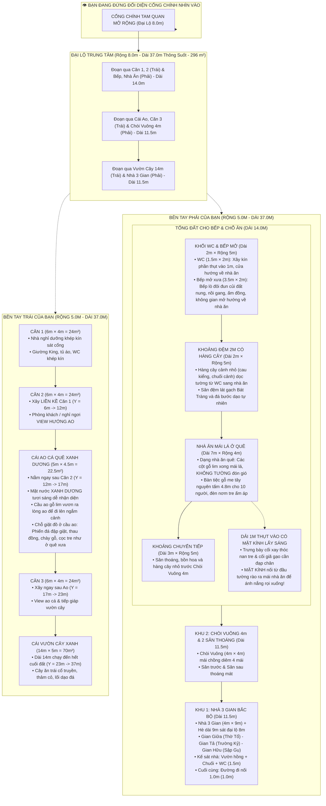

# BẢN THUYẾT MINH THIẾT KẾ QUY HOẠCH TOÀN DIỆN KHU NHÀ DÒNG HỌ
**Khuôn viên: 37.0m × 18.0m (Tổng diện tích: 666.0 m²)**
*Phiên bản quy hoạch cập nhật mới nhất: Đại lộ 8.0m, Dãy Trái 3 Căn 6x4 + Ao + Vườn 14m, Dãy Phải Cải Tạo Khối Bếp Mở - WC - Nhà Ăn Mái Lá 7m × 4m & Mái Kính Lấy Sáng Cối Xay Cối Giã*

---

## 1. TỔNG THỂ QUY HOẠCH VÀ HƯỚNG NHÌN

* **Vị trí đứng quan sát:** Người quan sát đứng ở **bên ngoài đối diện cổng chính nhìn thẳng vào khuôn viên**:
  * **Trục giữa:** Đại lộ chính mở rộng lên **8.0m** (thêm 2.0m mỗi bên theo đúng yêu cầu), kéo dài thông suốt **37.0m** từ cổng vào đến hết khu đất ($X \in [5.0, 13.0\text{m}]$, diện tích $296.0\text{ m}^2$).
  * **Bên tay trái của bạn (Dãy Trái - Rộng 5.0m, $X \in [0.0, 5.0\text{m}]$):**
    * Bỏ chỗ ngắm ao cũ, đổi thành **2 căn nhà liền nhau 6×4** ($Y = 0.0 \rightarrow 12.0\text{m}$).
    * Sau đó là **Cái Ao cá quê** ($Y = 12.0 \rightarrow 17.0\text{m}$, dài $5.0\text{m}$).
    * Sau đó thêm **1 căn nhà 6×4** ($Y = 17.0 \rightarrow 23.0\text{m}$, dài $6.0\text{m}$).
    * Toàn bộ phần còn lại đến cuối đất là **Cái Vườn cây xanh** ($Y = 23.0 \rightarrow 37.0\text{m}$, dài $14.0\text{m} \times$ rộng $5.0\text{m} = 70.0\text{ m}^2$).
  * **Bên tay phải của bạn (Dãy Phải - Rộng 5.0m, $X \in [13.0, 18.0\text{m}]$):**
    * Thu nhỏ bề rộng xây dựng công trình xuống còn **$4.0\text{m}$** ($X \in [13.0, 17.0\text{m}]$) + dải lùi ven tường ngoài **$1.0\text{m}$** ($X \in [17.0, 18.0\text{m}]$).
    * **Tổng đất cho Bếp & Chỗ Ăn là 14.0m tính từ cổng vào ($Y = 0.0 \rightarrow 14.0\text{m}$):**
      * **Khối WC & Bếp Mở ($Y = 0.0 \rightarrow 2.0\text{m}$, Ngang 5.0m, Dài 2.0m):**
        * **Nhà vệ sinh (WC):** Chiếm **$1.5\text{m}$** chiều rộng ($X \in [16.5, 18.0\text{m}]$), xây kín phần thụt vào 1m, cửa nhà vệ sinh hướng về phía nhà ăn ($+Y$).
        * **Bếp:** Rộng **$3.5\text{m}$** ($X \in [13.0, 16.5\text{m}]$), thiết kế đơn giản không gian mở như nhà bếp ngày xưa, mở toang về hướng nhà ăn, bếp lò đôi đun củi đất nung đỏ lửa, nồi gang, ấm đồng, chạn tre, bàn đá xanh. (Bếp và WC rộng bằng nhau theo chiều sâu $2.0\text{m}$).
      * **Khoảng cách đệm 2m ($Y = 2.0 \rightarrow 4.0\text{m}$):** Sân đệm kết nối thông thoáng, trồng **hàng cây cảnh nhỏ** thanh lịch dọc đoạn tường từ WC đến nhà ăn (cau kiểng mini, chuối cảnh).
      * **Nhà Ăn Mái Lá Ở Quê ($Y = 4.0 \rightarrow 11.0\text{m}$, Dài 7.0m × Rộng 4.0m):** Dạng nhà ăn mái lá quê, các cột gỗ tròn xong mái lá, **không tường** (mở toang 4 bề đón gió). Bàn tiệc gỗ me tây nguyên tấm dài 4.8m cho 10 người, đèn nơm tre ấm áp.
      * **Dải 1m thụt vào bên hông ($X \in [17.0, 18.0\text{m}]$, $Y = 4.0 \rightarrow 11.0\text{m}$):** Trưng bày Cối xay thóc nan tre $\rightarrow$ Rặng trúc quân tử $\rightarrow$ Cối giã gạo cần đạp chân. **Đặc biệt có MẶT KÍNH nghiêng nối từ đầu tường rào ($Z = 2.4\text{m}$) ra mép mái nhà ăn ($Z = 3.15\text{m}$)** để ánh nắng mặt trời rọi thẳng xuống không gian kỷ vật!
      * **Khoảng chuyển tiếp còn lại ($Y = 11.0 \rightarrow 14.0\text{m}$, Dài 3.0m × Rộng 5.0m):** Sân lát đá bước dạo, điểm xuyết các khóm cây cảnh và bồn hoa nhỏ chuyển tiếp sang Chòi Vuông 4x4.
    * **Khu 2 ($Y = 14.0 \rightarrow 25.5\text{m}$):** Sân trước đón gió, **Chòi Vuông $4.0\text{m} \times 4.0\text{m}$** ($Y = 17.5 \rightarrow 21.5\text{m}$) mái chồng diêm 2 tầng 4 mái đỉnh hồ lô vàng, Sân sau thoáng mát.
    * **Khu 1 ($Y = 25.5 \rightarrow 37.0\text{m}$):** Nhà 3 Gian Bắc Bộ ($4\text{m} \times 9\text{m}$), Hè dài 9m sát đại lộ 8m, Cụm phụ trợ (Vườn hồng, Bụi chuối, WC gia đình), Đường nối 1m.

---

## 2. BẢNG TỔNG HỢP KÍCH THƯỚC & DIỆN TÍCH (CHUẨN XÁC 100%)

| Khu Vực | Chiều Rộng ($X$) | Chiều Dài ($Y$) | Tọa Độ $Y$ (m) | Diện Tích Sàn / Mặt Nước | Đặc Điểm Kiến Trúc |
| :--- | :---: | :---: | :---: | :---: | :--- |
| **ĐẠI LỘ CHÍNH** | **8.0m** | **37.0m** | $0.0 \rightarrow 37.0$ | **296.0 m²** | Lát đá bazan xám đen, vỉa hè, đèn đá cổ truyền dẫn lối |
| **DÃY TRÁI** | **5.0m** | **37.0m** | $0.0 \rightarrow 37.0$ | **185.0 m²** | 3 Căn 6x4 + Ao cá + Vườn cây 14m |
| • Căn 1 (6x4) | 4.0m (+1m lùi) | 6.0m | $0.0 \rightarrow 6.0$ | 24.0 m² | Giường King, tủ áo, bàn việc, WC khép kín |
| • Căn 2 (6x4) | 4.0m (+1m lùi) | 6.0m | $6.0 \rightarrow 12.0$ | 24.0 m² | Liền kề Căn 1, phòng khách / nghỉ view hướng ao |
| • Cái Ao Cá Quê | 4.5m | 5.0m | $12.0 \rightarrow 17.0$ | 22.5 m² | Nước xanh dương, cầu ao gỗ lim ngắm cảnh, bến giặt đồ xưa |
| • Căn 3 (6x4) | 4.0m (+1m lùi) | 6.0m | $17.0 \rightarrow 23.0$ | 24.0 m² | Căn độc lập sau ao, view ao cá và tiếp giáp vườn |
| • Cái Vườn Cây | 5.0m | 14.0m | $23.0 \rightarrow 37.0$ | 70.0 m² | Cây ăn trái, thảm cỏ, lối dạo đá đến hết cuối đất |
| **DÃY PHẢI (TỔNG 14M BẾP & ĂN)** | **5.0m** | **14.0m** | $0.0 \rightarrow 14.0$ | **70.0 m²** | Cụm Bếp mở, WC, Hàng cây 2m, Nhà ăn mái lá 7x4 & Kính lấy sáng |
| • Nhà Vệ Sinh (WC) | 1.5m | 2.0m | $0.0 \rightarrow 2.0$ | 3.0 m² | Xây kín phần thụt vào 1m, cửa hướng về nhà ăn |
| • Bếp Mở Thôn Quê | 3.5m | 2.0m | $0.0 \rightarrow 2.0$ | 7.0 m² | Không gian mở, bếp lò củi đất nung, nồi gang, ấm đồng, bàn đá |
| • Khoảng Đệm Hàng Cây | 5.0m | 2.0m | $2.0 \rightarrow 4.0$ | 10.0 m² | Sân đệm Bát Tràng, hàng cau kiểng/chuối cảnh nhỏ dọc tường |
| • Nhà Ăn Mái Lá Ở Quê | 4.0m | 7.0m | $4.0 \rightarrow 11.0$ | 28.0 m² | Dạng mái lá quê, các cột gỗ lim xong mái lá, KHÔNG TƯỜNG |
| • Dải Kỷ Vật & MÁI KÍNH | 1.0m (ven tường) | 7.0m | $4.0 \rightarrow 11.0$ | 7.0 m² | Cối xay nan tre & Cối giã gạo, MẶT KÍNH nghiêng rọi nắng xuống |
| • Khoảng Chuyển Tiếp | 5.0m | 3.0m | $11.0 \rightarrow 14.0$ | 15.0 m² | Sân thoáng, bồn hoa và cây cảnh nhỏ trước Chòi Vuông 4m |
| **DÃY PHẢI (CÁC PHẦN TIẾP THEO)** | **5.0m** | **23.0m** | $14.0 \rightarrow 37.0$ | **115.0 m²** | Chòi Vuông 4m và Nhà 3 Gian Bắc Bộ |
| • Sân & Chòi Vuông 4m | 4.0m | 11.5m | $14.0 \rightarrow 25.5$ | 46.0 m² | Chòi vuông 4x4m mái chồng diêm 4 mái đỉnh hồ lô vàng |
| • Nhà 3 Gian Bắc Bộ | 4.0m | 9.0m | $25.5 \rightarrow 34.5$ | 36.0 m² | Gỗ lim, án gian thếp vàng, sập gụ, trường kỷ, hè 9m |
| • Cụm Phụ Trợ & Đường 1m | 4.0m / 5.0m | 2.5m | $34.5 \rightarrow 37.0$ | 11.0 m² | Vườn hồng, bụi chuối, WC gia đình và đường nối thông hành |
| **TỔNG CỘNG** | **18.0m** | **37.0m** | | **666.0 m²** | **Khớp 100% diện tích và kích thước khuôn viên** |

---

## 3. CHI TIẾT CẢI TẠO KHU BẾP, WC & NHÀ ĂN MÁI LÁ DÃY PHẢI (14M)

### 3.1. Khối Nhà Vệ Sinh (WC) & Bếp Mở Dân Dã ($Y = 0.0 \rightarrow 2.0\text{m}$, Ngang 5.0m, Dài 2.0m)
* **Tổng thể khối:** Chiều ngang đúng 5.0m ($X \in [13.0, 18.0\text{m}]$), chiều dài dọc đất là 2.0m ($Y \in [0.0, 2.0\text{m}]$). Bếp và nhà vệ sinh rộng bằng nhau theo chiều sâu 2.0m.
* **Nhà vệ sinh (WC) ($X \in [16.5, 18.0\text{m}]$, Rộng 1.5m × Dài 2.0m):**
  * **Xây kín phần thụt vào 1m:** Phần thụt vào 1m giáp tường rào ngoài ($X \in [17.0, 18.0\text{m}]$) được xây tường kín bao bọc hoàn toàn cùng với phần mở rộng thêm 0.5m tạo thành một buồng vệ sinh tiện nghi kích thước $1.5\text{m} \times 2.0\text{m} = 3.0\text{ m}^2$.
  * **Cửa nhà vệ sinh:** Trổ ở bức tường phía Bắc ($Y = 2.0\text{m}$), **hướng thẳng về phía nhà ăn** qua khoảng đệm cây xanh 2m. Cửa gỗ tự nhiên kín đáo, lắp tay gạt kim loại sang trọng.
  * **Nội thất WC:** Lát sàn đá slate chống trơn, bồn cầu sứ trắng nano kháng khuẩn, bàn lavabo đá đen marble với chậu rửa sứ âm bàn, vòi sen và gương soi cao cấp.
* **Bếp đơn giản không gian mở như ngày xưa ($X \in [13.0, 16.5\text{m}]$, Rộng 3.5m × Dài 2.0m):**
  * **Không gian mở mộc mạc:** Không xây tường bít bùng. Phía Bắc ($Y = 2.0\text{m}$) **mở toang hoàn toàn hướng về phía nhà ăn**, chỉ sử dụng các cột gỗ tròn chịu lực và xà ngang đỡ vì kèo. Phía Tây giáp đại lộ 8m có quầy bếp lửng cao 0.8m ốp gạch mộc và phiến đá xanh làm bàn chuẩn bị. Phía Nam tựa lưng vào tường rào kiên cố.
  * **Bếp lò đôi đất sét nung đun củi:** Tái hiện bếp củi cổ truyền với 2 miệng bếp kiềng sắt, than hồng đỏ rực bập bùng, 2 chiếc nồi gang đen truyền thống, ấm đun nước đồng cổ và ống khói đất nung vươn cao thoát nhiệt.
  * **Nội thất bếp xưa:** Bàn sơ chế thức ăn mặt đá xanh mộc, chậu gốm, kệ chạn bát đan bằng nan tre treo tường đựng bát đĩa gốm Bát Tràng, bó củi khô xếp gọn gàng gầm kệ bếp, nia tre/mẹt tre treo trang trí và đèn nơm tre ấm áp.
* **Mái che khối Bếp & WC:** Mái dốc 2 mái ngói đỏ Bát Tràng che phủ toàn bộ khối 5m x 2m, kết nối hài hòa với tường rào và cảnh quan.

### 3.2. Khoảng Đệm 2m Có Hàng Cây Xanh ($Y = 2.0 \rightarrow 4.0\text{m}$, Dài 2.0m × Rộng 5.0m)
* **Khoảng cách 2m:** Từ cửa bếp và cửa WC cách ra đúng 2.0m mới bắt đầu bước vào hiên nhà ăn.
* **Hàng cây xanh nhỏ dọc tường:** Toàn bộ đoạn 2m ven tường rào ranh đất ($X \in [16.5, 18.0\text{m}]$, $Y \in [2.0, 4.0\text{m}]$) được bố trí bồn cỏ xanh và **hàng cây cảnh nhỏ thanh lịch** (3 cây cau kiểng mini / chuối cảnh nhỏ thanh mảnh cao 1.6m - 1.8m) tạo mảng xanh mềm mại, ngăn mùi và lọc không khí giữa khu vệ sinh/bếp với khu vực ăn uống.
* **Sân đệm kết nối:** Lát gạch gốm Bát Tràng kết hợp các phiến đá xanh bước dạo tự nhiên tròn trịa, điểm thêm 2 bụi hoa nhỏ xinh xắn mép đường 8m.

### 3.3. Nhà Ăn Mái Lá Ở Quê ($Y = 4.0 \rightarrow 11.0\text{m}$, Dài 7.0m × Rộng 4.0m)
* **Kích thước chuẩn:** Chiều dài đúng **$7.0\text{m}$**, chiều rộng đúng **$4.0\text{m}$** ($X \in [13.0, 17.0\text{m}]$), nhường dải 1m bên hông ($X \in [17.0, 18.0\text{m}]$) cho hành lang cối xay cối giã.
* **Kiến trúc mái lá quê:**
  * **Các cột xong mái lá, KHÔNG TƯỜNG:** Đúng chuẩn nhà ăn thôn quê xưa, mở toang 4 bề đón trọn làn gió mát lành thổi từ ao cá xanh dương và vườn cây bên trái sang.
  * **Hệ cột gỗ lim vững chãi:** 4 cặp cột tròn tự nhiên (8 cột) đường kính 22cm đặt trên chân tảng đá xanh hoa sen bồng, hệ xà ngang vì kèo và xà dọc giằng mái chắc chắn.
  * **Mái lá cọ / rơm rạ truyền thống:** 2 mái dốc dày dặn, độ vươn mái lớn che mưa chắn nắng, bờ nóc nẹp tre bó cổ truyền.
* **Nội thất bàn ăn:**
  * Bàn tiệc gỗ me tây nguyên tấm dân dã dài 4.8m x rộng 1.6m, bố trí 10 ghế ăn gỗ lim chuẩn tỷ lệ.
  * 3 Đèn nơm tre dân dã treo thả trần lung linh, ấm áp.

### 3.4. Dải 1m Thụt Vào & MẶT KÍNH LẤY SÁNG RỌI CỐI XAY CỐI GIÃ ($X \in [17.0, 18.0\text{m}]$, $Y = 4.0 \rightarrow 11.0\text{m}$)
* **Kích thước:** Rộng $1.0\text{m} \times$ Dài $7.0\text{m}$, chạy dọc suốt bên hông Nhà Ăn.
* **Trưng bày bảo tồn kỷ vật quê xưa:**
  * Nền rải sỏi cuội trắng và phiến đá xanh bước dạo tròn.
  * **Cối xay thóc nan tre (tại $Y = 6.0\text{m}$):** Thớt dưới đất nung đan nan tre, cối trên, vành tre, cần giằng gỗ treo từ xà xuống.
  * **Rặng trúc quân tử xanh mát (tại $Y = 7.4 \rightarrow 8.0\text{m}$):** Điểm nhấn xanh phân chia nhịp nhàng giữa hai cụm kỷ vật.
  * **Cối giã gạo cần đạp chân cổ truyền (tại $Y = 9.4\text{m}$):** Cối đá xanh nguyên khối, cần đạp gỗ lim dài 2.0m có chày giã hạ vào lòng cối đá.
* **MẶT KÍNH NỐI TỪ ĐẦU TƯỜNG RA MÁI ĐỂ ÁNH NẮNG RỌI XUỐNG (Skylight Canopy):**
  * Tấm kính cường lực trong suốt dốc nghiêng nối từ **đỉnh tường rào ranh đất** ($X = 18.0\text{m}$, cao độ $Z = 2.40\text{m}$) lên thẳng **mép xà mái nhà ăn** ($X = 17.0\text{m}$, cao độ $Z = 3.15\text{m}$).
  * Hệ đòn tay thép đen và viền nhôm thanh mảnh đỡ kính trải dài suốt 7m.
  * Ánh sáng mặt trời tự nhiên rọi thẳng qua lớp kính xuống cối xay thóc và cối giã gạo, tạo nên hiệu ứng giếng trời bảo tàng văn hóa tuyệt đẹp, vừa bảo vệ kỷ vật không bị mưa ướt vừa ngập tràn ánh nắng!

### 3.5. Khoảng Chuyển Tiếp Còn Lại ($Y = 11.0 \rightarrow 14.0\text{m}$, Dài 3.0m × Rộng 5.0m)
* Nền lát gạch Bát Tràng và đá xanh bazan, có đá bước dạo tự nhiên.
* Bố trí các chậu cây cảnh nhỏ, bồn hoa mini làm duyên ("chỗ nào trống thì thêm tí hàng cây vào nhưng nhỏ thôi") kết nối êm ái sang khoảng sân trước của Chòi Vuông 4x4.
