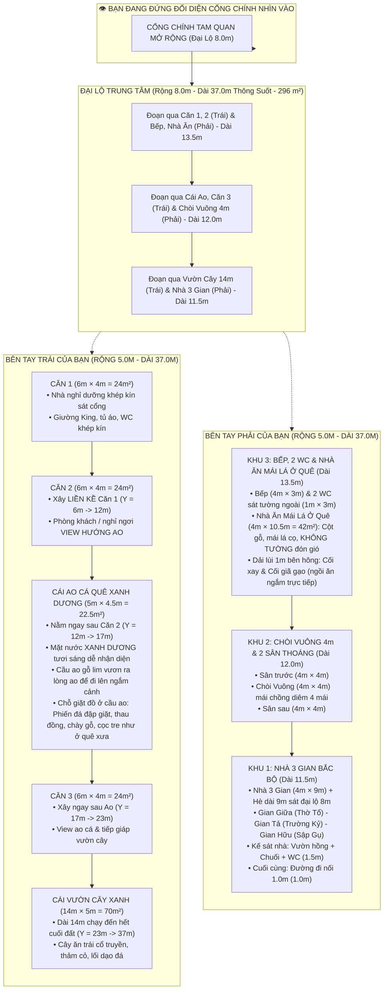

# BẢN THUYẾT MINH THIẾT KẾ QUY HOẠCH TOÀN DIỆN KHU NHÀ DÒNG HỌ
**Khuôn viên: 37.0m × 18.0m (Tổng diện tích: 666.0 m²)**
*Phiên bản quy hoạch cập nhật mới nhất: Đại lộ 8.0m, Dãy Trái 3 Căn 6x4 + Ao + Vườn 14m, Dãy Phải Chòi Vuông 4m & Nhà 3 Gian*

---

## 1. TỔNG THỂ QUY HOẠCH VÀ HƯỚNG NHÌN

* **Vị trí đứng quan sát:** Người quan sát đứng ở **bên ngoài đối diện cổng chính nhìn thẳng vào khuôn viên**:
  * **Trục giữa:** Đại lộ chính mở rộng lên **8.0m** (thêm 2.0m mỗi bên theo đúng yêu cầu), kéo dài thông suốt **37.0m** từ cổng vào đến hết khu đất ($X \in [5.0, 13.0\text{m}]$, diện tích $296.0\text{ m}^2$).
  * **Bên tay trái của bạn (Dãy Trái - Rộng 5.0m, $X \in [0.0, 5.0\text{m}]$):**
    * Bỏ chỗ ngắm ao cũ, đổi thành **2 căn nhà liền nhau 6×4** ($Y = 0.0 \rightarrow 12.0\text{m}$).
    * Sau đó là **Cái Ao cá quê** ($Y = 12.0 \rightarrow 17.0\text{m}$, dài $5.0\text{m}$).
    * Sau đó thêm **1 căn nhà 6×4** ($Y = 17.0 \rightarrow 23.0\text{m}$, dài $6.0\text{m}$).
    * Toàn bộ phần còn lại đến cuối đất là **Cái Vườn cây xanh** ($Y = 23.0 \rightarrow 37.0\text{m}$, dài $14.0\text{m} \times$ rộng $5.0\text{m} = 70.0\text{ m}^2$).
  * **Bên tay phải của bạn (Dãy Phải - Rộng 5.0m, $X \in [13.0, 18.0\text{m}]$):**
    * Thu nhỏ bề rộng xây dựng công trình xuống còn **$4.0\text{m}$** ($X \in [13.0, 17.0\text{m}]$) + dải lùi ven tường ngoài **$1.0\text{m}$** ($X \in [17.0, 18.0\text{m}]$).
    * **Khu 3 ($Y = 0.0 \rightarrow 13.5\text{m}$):** Bếp ($4\text{m} \times 3\text{m}$) & 2 WC sát tường ngoài + Nhà Ăn Gia Tộc ($4\text{m} \times 10.5\text{m} = 42\text{m}^2$) & Dải lùi Kỷ vật 1m ngắm cối xay cối giã qua kính.
    * **Khu 2 ($Y = 13.5 \rightarrow 25.5\text{m}$):** Sân trước $4\text{m} \times 4\text{m}$, **Chòi Vuông $4.0\text{m} \times 4.0\text{m}$** (rút gọn từ lục giác) mái chồng diêm 2 tầng 4 mái đỉnh hồ lô vàng, Sân sau $4\text{m} \times 4\text{m}$.
    * **Khu 1 ($Y = 25.5 \rightarrow 37.0\text{m}$):** Nhà 3 Gian Bắc Bộ ($4\text{m} \times 9\text{m}$), Hè dài 9m sát đại lộ 8m, Cụm phụ trợ (Vườn hồng, Bụi chuối, WC dài $1.5\text{m}$), Đường nối 1m ($1.0\text{m}$).

---

## 2. BẢNG TỔNG HỢP KÍCH THƯỚC & DIỆN TÍCH (CHUẨN XÁC 100%)

| Khu Vực | Chiều Rộng ($X$) | Chiều Dài ($Y$) | Tọa Độ $Y$ (m) | Diện Tích Sàn / Mặt Nước | Đặc Điểm Kiến Trúc |
| :--- | :---: | :---: | :---: | :---: | :--- |
| **ĐẠI LỘ CHÍNH** | **8.0m** | **37.0m** | $0.0 \rightarrow 37.0$ | **296.0 m²** | Lát đá bazan xám đen, vỉa hè, đèn đá cổ truyền dẫn lối |
| **DÃY TRÁI** | **5.0m** | **37.0m** | $0.0 \rightarrow 37.0$ | **185.0 m²** | 3 Căn 6x4 + Ao cá + Vườn cây 14m |
| • Căn 1 (6x4) | 4.0m (+1m lùi) | 6.0m | $0.0 \rightarrow 6.0$ | 24.0 m² | Giường King, tủ áo, bàn việc, WC khép kín |
| • Căn 2 (6x4) | 4.0m (+1m lùi) | 6.0m | $6.0 \rightarrow 12.0$ | 24.0 m² | Liền kề Căn 1, phòng khách / nghỉ view hướng ao |
| • Cái Ao Cá Quê | 4.5m | 5.0m | $12.0 \rightarrow 17.0$ | 22.5 m² | Kè đá cuội, cầu ao gỗ lim, hoa sen, hoa súng |
| • Căn 3 (6x4) | 4.0m (+1m lùi) | 6.0m | $17.0 \rightarrow 23.0$ | 24.0 m² | Căn độc lập sau ao, view ao cá và tiếp giáp vườn |
| • Cái Vườn Cây | 5.0m | 14.0m | $23.0 \rightarrow 37.0$ | 70.0 m² | Cây ăn trái, thảm cỏ, lối dạo đá đến hết cuối đất |
| **DÃY PHẢI** | **5.0m** | **37.0m** | $0.0 \rightarrow 37.0$ | **185.0 m²** | Bếp, Nhà Ăn, Chòi Vuông 4m, Nhà 3 Gian |
| • Khu Bếp Nấu | 4.0m | 3.0m | $0.0 \rightarrow 3.0$ | 12.0 m² | Bếp L đá hoa cương, hút mùi, liên thông nhà ăn |
| • 2 Nhà Vệ Sinh | 1.0m (sát tường) | 3.0m | $0.0 \rightarrow 3.0$ | 3.0 m² | 2 buồng độc lập phục vụ khách và ngày lễ hội |
| • Nhà Ăn Gia Tộc | 4.0m | 10.5m | $3.0 \rightarrow 13.5$ | 42.0 m² | Bàn ăn thông minh kéo dài 5.2m, vách kính lớn |
| • Dải Lùi Kỷ Vật | 1.0m (ven tường) | 10.5m | $3.0 \rightarrow 13.5$ | 10.5 m² | Trưng bày cối xay nan tre & cối giã gạo cần đạp |
| • Sân Trước Chòi | 4.0m | 4.0m | $13.5 \rightarrow 17.5$ | 16.0 m² | Khoảng sân thoáng đón gió mát cho chòi |
| • Chòi Vuông 4m | 4.0m | 4.0m | $17.5 \rightarrow 21.5$ | 16.0 m² | Chòi vuông mái chồng diêm 4 mái đỉnh hồ lô vàng |
| • Sân Sau Chòi | 4.0m | 4.0m | $21.5 \rightarrow 25.5$ | 16.0 m² | Khoảng sân đệm thoáng giữa chòi và nhà 3 gian |
| • Nhà 3 Gian Bắc Bộ | 4.0m | 9.0m | $25.5 \rightarrow 34.5$ | 36.0 m² | Gỗ lim, ngói mũi hài, án gian thếp vàng, sập gụ, trường kỷ |
| • Hè Nhà 3 Gian | 0.9m | 9.0m | $25.5 \rightarrow 34.5$ | 8.1 m² | Hè sát mép đại lộ 8m, 4 cột hiên lim kê đá hoa sen |
| • Cụm Phụ Trợ | 4.0m | 1.5m | $34.5 \rightarrow 36.0$ | 6.0 m² | Vườn hồng thơm ngát, bụi chuối thôn quê, WC gia đình |
| • Đường Nối 1.0m | 5.0m | 1.0m | $36.0 \rightarrow 37.0$ | 5.0 m² | Lối đi thông hành nối dải lùi ra đại lộ 8m |
| **TỔNG CỘNG** | **18.0m** | **37.0m** | | **666.0 m²** | **Khớp 100% diện tích và kích thước khuôn viên** |

---

## 3. CHI TIẾT DÃY TRÁI (3 CĂN NHÀ 6×4, AO CÁ VÀ VƯỜN 14M)

### 3.1. Căn 1 (6×4) - Nhà Nghỉ Dưỡng Cạnh Cổng ($Y = 0.0 \rightarrow 6.0\text{m}$)
* Kích thước: Rộng $4.0\text{m} \times$ Dài $6.0\text{m}$ (diện tích sàn $24.0\text{ m}^2$).
* Khoảng lùi: Tường ngoài lùi $1.0\text{m}$ so với ranh đất tạo dải thông gió và kỹ thuật.
* Công năng: Phòng ngủ khép kín độc lập, trang bị giường King-size gỗ tự nhiên, 2 tab đầu giường, tủ áo 3 cánh cao kịch trần, bàn làm việc và phòng tắm/WC khép kín tiện nghi.
* Cửa chính mở ra đại lộ 8m đón gió và ánh sáng tự nhiên. Mái ngói đỏ Bát Tràng dốc truyền thống.

### 3.2. Căn 2 (6×4) - Liền Kề Căn 1 & View Hướng Ao ($Y = 6.0 \rightarrow 12.0\text{m}$)
* Kích thước: Rộng $4.0\text{m} \times$ Dài $6.0\text{m}$ (diện tích sàn $24.0\text{ m}^2$).
* Kết cấu liền khối: Xây liền kề trực tiếp với Căn 1, chung tường chịu lực, tạo khối kiến trúc đôi dài 12m đăng đối, bề thế và tiết kiệm chi phí xây dựng.
* Công năng: Không gian phòng khách sinh hoạt chung / phòng nghỉ ngơi sang trọng. Trang bị bộ sofa gỗ tự nhiên, bàn trà me tây, quầy bar mini-pantry và WC khép kín.
* Điểm nhấn cảnh quan: Tường hồi phía sau tiếp giáp trực tiếp mép Ao Cá Quê ($Y = 12.0\text{m}$) được trổ vách kính lớn trong suốt, ngắm trọn mặt nước ao cá và hoa sen nở.

### 3.3. Cái Ao Cá Quê Truyền Thống ($Y = 12.0 \rightarrow 17.0\text{m}$)
* Kích thước: Dài $5.0\text{m} \times$ Rộng $4.5\text{m}$ (diện tích mặt nước $22.5\text{ m}^2$).
* Vị trí: Nằm ngay giữa Căn 2 và Căn 3, tạo khoảng đệm thủy đình mát rượi, thanh bình.
* Bờ kè & Cầu ao:
  * Mép bờ kè đá cuội sông tự nhiên bo viền mộc mạc, giữ đất và tạo dáng mềm mại.
  * Cầu ao ván gỗ lim mộc mạc bắc ra mép nước (nét sinh hoạt thôn quê Bắc Bộ thân thương).
* Thủy sinh & Sinh thái:
  * Thả các loại cá ao quê truyền thống: Cá chép đồng, chép vàng, chép đỏ bơi lội thanh bình.
  * Cụm hoa súng, hoa sen nở rộ tỏa hương và khóm thủy trúc ven bờ.
  * Điều hòa vi khí hậu mát mẻ tự nhiên cho toàn bộ khu nhà khách và khuôn viên.

### 3.4. Căn 3 (6×4) - Nhà Nghỉ Biệt Lập Kế Sau Ao ($Y = 17.0 \rightarrow 23.0\text{m}$)
* Kích thước: Rộng $4.0\text{m} \times$ Dài $6.0\text{m}$ (diện tích sàn $24.0\text{ m}^2$).
* Vị trí phong thủy tuyệt đẹp: Nằm độc lập ngay sau cái ao cá ($Y = 17.0\text{m}$) và trước vườn cây xanh mát ($Y = 23.0\text{m}$).
  * Phía trước mở cửa nhìn ngắm mặt nước ao cá và cầu ao gỗ.
  * Phía sau tiếp giáp trực tiếp với rặng cây xanh mát của khu vườn 14m.
* Công năng: Căn nghỉ dưỡng tĩnh lặng, đầy đủ giường ngủ, tủ kệ, bàn trà và WC khép kín.
* Đối diện sang Chòi Vuông 4m qua đại lộ 8.0m.

### 3.5. Cái Vườn Cây Xanh Mát 14m ($Y = 23.0 \rightarrow 37.0\text{m}$)
* Kích thước: Dài $14.0\text{m} \times$ Rộng $5.0\text{m}$ (diện tích $70.0\text{ m}^2$).
* Vị trí: Chiếm trọn chiều dài 14m còn lại của Dãy Trái đến tận tường bao cuối đất, nằm đối diện trực tiếp với Nhà 3 Gian Bắc Bộ qua đại lộ 8m.
* Cảnh quan sinh thái:
  * Trồng các loại cây ăn trái và hoa quý Bắc Bộ: Bưởi Diễn, khế ngọt, hoa mộc hương, ngọc lan tỏa hương thoang thoảng.
  * Lối dạo quanh co lát đá phiến tự nhiên trên nền thảm cỏ xanh mướt.
  * Đón gió mát trong lành thổi ngang qua đại lộ 8m vào hiên Nhà 3 Gian.

---

## 4. CHI TIẾT DÃY PHẢI (BẾP, NHÀ ĂN, CHÒI VUÔNG 4M & NHÀ 3 GIAN)

### 4.1. Khu 3: Bếp, 2 WC & Nhà Ăn Gia Tộc ($Y = 0.0 \rightarrow 13.5\text{m}$)
* **Bếp nấu hiện đại ($Y = 0.0 \rightarrow 3.0\text{m}$, $4.0\text{m} \times 3.0\text{m} = 12\text{m}^2$):** Bàn bếp chữ L đá hoa cương, bồn rửa đôi, máy hút mùi công suất lớn, cửa thông tiện lợi sang phòng ăn.
* **2 Nhà vệ sinh sát tường ($Y = 0.0 \rightarrow 3.0\text{m}$, $1.0\text{m} \times 3.0\text{m}$):** Xây dựng trên dải 1m sát tường rào ngoài theo chỉ đạo của bạn. 2 buồng độc lập phục vụ khách và ngày hội họp dòng họ.
* **Nhà Ăn Gia Tộc ($Y = 3.0 \rightarrow 13.5\text{m}$, $4.0\text{m} \times 10.5\text{m} = 42\text{m}^2$):**
  * Sức chứa 25 - 40 người trong các dịp đại lễ dòng họ.
  * Bàn ăn thông minh tròn mở rộng thành oval/chữ nhật dài 5.2m.
* **Hành lang Kỷ vật xưa ($1.0\text{m} \times 10.5\text{m}$):** Dải lùi 1m bên hông Nhà Ăn rải sỏi trắng, trồng rặng trúc quân tử và đèn rọi ấm áp. Đặt Cối xay thóc nan tre truyền thống và Cối giã gạo cần đạp chân gỗ lim chữ Y để con cháu vừa ngồi ăn vừa ngắm nhìn qua vách kính lớn.

### 4.2. Khu 2: Chòi Vuông 4.0m & 2 Khoảng Sân Thoáng ($Y = 13.5 \rightarrow 25.5\text{m}$)
* **Rút gọn từ đài lục giác xuống chòi vuông 4.0m** theo đúng yêu cầu:
  * Kích thước Chòi Vuông: Rộng đúng $4.0\text{m} \times$ Dài $4.0\text{m}$ ($X \in [13.0, 17.0\text{m}]$, $Y \in [17.5, 21.5\text{m}]$).
  * Kết cấu: 4 cột gỗ lim đường kính 22cm kê chân tảng đá hoa sen bồng trên bệ đá xanh Thanh Hóa giật cấp vững chãi.
  * Mái kiến trúc: Mái 2 tầng chồng diêm 4 mái hình kim tự tháp (tứ giác), lợp ngói đỏ Bát Tràng, đỉnh đắp bình hồ lô thếp vàng uy nghi.
  * Nội thất: Bàn trà vuông gỗ gụ ở giữa cùng 4 ghế tựa thưởng trà ngắm cảnh sang ao cá Dãy Trái.
* **2 Khoảng sân thoáng trước & sau ($4.0\text{m} \times 4.0\text{m}$ mỗi sân):**
  * Sân trước ($Y = 13.5 \rightarrow 17.5\text{m}$) và Sân sau ($Y = 21.5 \rightarrow 25.5\text{m}$) để trống hoàn toàn, lát đá tự nhiên chống trơn, tạo không gian đón gió mát lành cho chòi vuông và khuôn viên.

### 4.3. Khu 1: Nhà 3 Gian Bắc Bộ Truyền Thống ($Y = 25.5 \rightarrow 37.0\text{m}$)
* **Nhà 3 Gian Bắc Bộ ($Y = 25.5 \rightarrow 34.5\text{m}$, $4.0\text{m} \times 9.0\text{m} = 36\text{m}^2$):**
  * Rút gọn bề rộng xuống $4.0\text{m}$ để mở rộng đại lộ chính lên $8.0\text{m}$, bảo tồn nguyên vẹn tỷ lệ 3 gian truyền thống uy nghiêm.
  * **Hè dài 9m sát đường:** Nền hè rộng 0.9m chạy suốt 9m sát mép đại lộ 8m, 4 cột hiên gỗ lim trên chân tảng hoa sen bồng và bậc tam cấp đá xanh Thanh Hóa.
  * **Gian Giữa (Thờ Tổ Uy Nghiêm):** Án gian gỗ gụ sơn son thếp vàng 9999, ngai thờ tổ, bộ ngũ sự đồng cổ (đỉnh đồng, đôi chân nến, đôi hạc ngậm sen), cửa võng chạm tứ linh lộng lẫy, hoành phi 'Đức Lưu Quang', câu đối lòng máng chạm rồng, đôi lục bình men lam 1.8m vẽ khổng tước.
  * **Gian Tả (Tiếp Khách Trọng Thể):** Bộ trường kỷ gỗ lim chạm hạt cườm bóng loáng, khay trà gốm mộc Bát Tràng, điếu bát thuốc lào truyền thống, tủ chè gỗ gụ khảm ốc xà cừ ngũ sắc, tranh tứ bình Xuân - Hạ - Thu - Đông.
  * **Gian Hữu (Tĩnh Dưỡng & Gia Phả):** Sập gụ đại ba thành chạm ngũ phúc lâm môn nguyên tấm, gối xếp gấm đỏ hoa cúc dệt kim tuyến, bàn cờ tướng chân quỳ thấp, tủ kính lưu giữ gia phả dòng họ, bức thư pháp 'Tổ Đức Trường Tồn'.
* **Cụm phụ trợ sau nhà ($Y = 34.5 \rightarrow 36.0\text{m}$, Dài $1.5\text{m}$):** Vườn hoa hồng cổ thơm ngát đón gió, bụi chuối thôn quê che mát tường hồi theo phong thủy 'Trước cau, sau chuối', và 1 phòng Toilet gia đình kín đáo.
* **Đường nối 1.0m ($Y = 36.0 \rightarrow 37.0\text{m}$):** Lối đi thông hành nối dải lùi 1m ven tường ra trục đại lộ 8.0m.

---

## 5. CÔNG NGHỆ MÔ PHỎNG & TRẢI NGHIỆM TƯƠNG TÁC

1. **Website Trực Tuyến GitHub Pages:**
   * Truy cập mọi lúc, mọi nơi tại: `https://saikase.github.io/khu-nha-dong-ho/`
   * Tương thích hoàn hảo với máy tính, máy tính bảng và điện thoại di động mà không cần cài đặt phần mềm nào.
2. **Mô Hình 3D WebGL PBR (Xoay 360° Trực Tiếp):**
   * Khởi chạy mượt mà ngay trên trình duyệt web, dung lượng siêu nhẹ chỉ ~1.49 MB.
   * Xoay tự do mọi góc độ bằng chuột hoặc cảm ứng, bóc mái xem toàn bộ nội thất bên trong, đổi chế độ ngày/đêm và click vào từng công trình để xem thuyết minh chi tiết.
3. **Bộ 12 Phối Cảnh Raytracing Blender Cycles:**
   * Kết xuất siêu thực với độ phân giải cao 1600×900, mẫu chuẩn 4 hướng Đông - Tây - Nam - Bắc, cận cảnh ao cá, bóc mái nội thất và đại lộ 8.0m.
4. **Mặt Bằng 2D Blueprint SVG:**
   * Thể hiện chuẩn xác từng centimet theo tỷ lệ $1\text{m} = 18\text{px}$, tích hợp thước đo kích thước và nhấp chuột trực tiếp để xem thông số phân khu.
