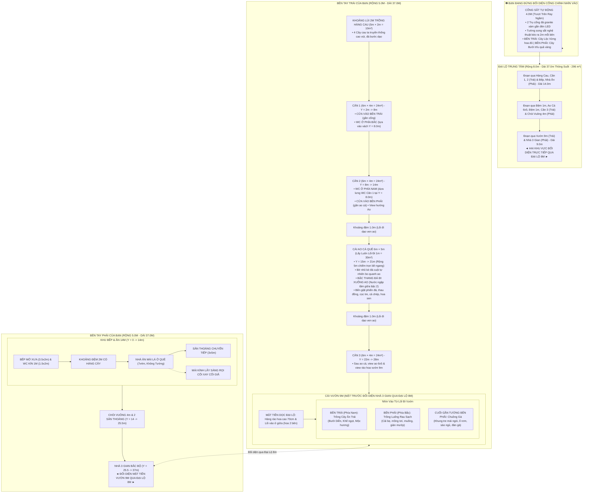

# BẢN THUYẾT MINH THIẾT KẾ QUY HOẠCH TOÀN DIỆN KHU NHÀ DÒNG HỌ
**Khuôn viên: 37.0m × 18.0m (Tổng diện tích: 666.0 m²)**
*Phiên bản quy hoạch cập nhật mới nhất: Mặt Trước Của Vườn Đối Diện Trực Tiếp Nhà 3 Gian Bắc Bộ, Cụm 2 Phòng 2 WC Dựa Lưng Nhau, Ao Cá 6x5 Bậc Thang Đá (Nước Ngập Giữa Bậc 2), Vườn 9m (Rau, Cây & Chuồng Gà)*

---

## 1. TỔNG THỂ QUY HOẠCH VÀ HƯỚNG NHÌN

* **Vị trí đứng quan sát:** Người quan sát đứng ở **bên ngoài đối diện cổng chính nhìn thẳng vào khuôn viên**:
  * **Trục giữa & Mặt tiền Cổng Chính ($X \in [5.0, 13.0\text{m}]$):**
    * Đại lộ trung tâm rộng **8.0m**, thông suốt **37.0m** từ cổng vào đến hết đất.
    * **Cổng sắt tự động chạy qua chạy lại** rộng **4.0m** ($X \in [7.0, 11.0\text{m}]$) với ray trượt âm sàn ngầm, mô tơ tự động điều khiển từ xa và 2 trụ cổng ốp đá granite xám gắn đèn LED.
    * **Tường song sắt kéo ra 2.0m mỗi bên:** 
      * Đoạn 2m bên trái cổng ($X \in [5.0, 7.0\text{m}]$) và đoạn 2m bên phải cổng ($X \in [11.0, 13.0\text{m}]$).
      * Toàn bộ tường mặt trước bằng hệ song sắt nghệ thuật xen kẽ cây xanh thông thoáng.
    * **Cây phong thủy sau phần song sắt 2m:**
      * **Bên phải cổng:** Trồng **CÂY BƯỞI** Diễn trĩu quả tròn vàng óng, mang lại tài lộc thịnh vượng.
      * **Bên trái cổng:** Trồng **CÂY LỘC VỪNG** hoa đỏ buông rủ đón sinh khí may mắn.
  * **Bên tay trái của bạn (Dãy Trái - Rộng 5.0m, Dài 37.0m):**
    * **Khoảng lùi 2m ($Y = 0.0 \rightarrow 2.0\text{m}$):** Dãy nhà thụt vào 2m để trồng **HÀNG CAU TA** truyền thống thẳng tắp cao vút $4.0\text{m} - 4.4\text{m}$ ("trước cau sau chuối"), thảm cỏ xanh và đá bước dạo tự nhiên.
    * **Căn 1 (6×4, $Y = 2.0 \rightarrow 8.0\text{m}$):** Phòng gần cổng, **cửa vào bố trí ở bên trái** (phía gần cổng). **Nhà vệ sinh đặt ở phía Bắc**, tựa lưng vào tường $Y = 8.0\text{m}$.
    * **Căn 2 (6×4, $Y = 8.0 \rightarrow 14.0\text{m}$):** Phòng nối tiếp, **cửa vào bố trí ở bên phải** (phía gần ao). **Nhà vệ sinh đặt ở phía Nam**, tựa lưng vào tường $Y = 8.0\text{m}$.
      * 👉 **ĐẶC ĐIỂM ƯU VIỆT:** **2 NHÀ VỆ SINH CỦA CĂN 1 VÀ CĂN 2 DỰA LƯNG HOÀN TOÀN VÀO NHAU** tại vách ngăn chung $Y = 8.0\text{m}$, dùng chung hộp kỹ thuật cấp thoát nước, cực kỳ gọn gàng và chuẩn kiến trúc thi công!
    * **Khoảng cách 1m ($Y = 14.0 \rightarrow 15.0\text{m}$):** Lối đi dạo kết nối từ đại lộ 8m sang bờ ao cá.
    * **Cái Ao Cá Quê 6×5 ($Y = 15.0 \rightarrow 21.0\text{m}$, Rộng 5.0m = $30.0\text{ m}^2$):**
      * Mở rộng chiếm trọn bề ngang 5m (**lấy luôn lối đi 1m** sát tường rào ngoài).
      * Xóa bỏ cầu ao cũ, thay thế bằng **bờ nhỏ kè đá cuội tự nhiên** bo quanh ao.
      * **Bậc thang đá xanh nguyên khối đi xuống ao:** Nước ao dâng đến **tầm giữa bậc 2** giống hệt ao làng quê xưa!
      * Cọc tre vịn tay cắm lòng ao, phiến đá giặt phẳng nhẵn, thau đồng và chày gỗ đập vải giặt đồ xưa.
      * Đàn cá chép đồng (7 chú cá chép bạc, vàng, đỏ) bơi lội trong làn nước xanh biếc, hoa sen hoa súng thơm ngát.
    * **Khoảng cách 1m ($Y = 21.0 \rightarrow 22.0\text{m}$):** Lối đi dạo ven bờ Bắc của ao dẫn vào Căn 3.
    * **Căn 3 (6×4, $Y = 22.0 \rightarrow 28.0\text{m}$):** Nhà nghỉ biệt lập view ao cá phía Nam và view vườn hoa phía Bắc.
    * **Cái Vườn Cây Rút Gọn 9m ($Y = 28.0 \rightarrow 37.0\text{m}$, Rộng 5.0m = $45.0\text{ m}^2$):**
      * 🏛️ **MẶT TRƯỚC CỦA VƯỜN ĐỐI DIỆN TRỰC TIẾP NHÀ 3 GIAN BẮC BỘ:**
        * Nằm dọc theo mép đại lộ chính 8.0m ($X = 5.0\text{m}$), nhìn thẳng sang hiên Nhà 3 Gian ($X = 13.0\text{m}$).
        * **Hàng rào bụi hoa cao khoảng 70cm** chạy suốt chiều dài 9m mép đại lộ, nở hoa đỏ, vàng, tím rực rỡ.
        * **Đường đi vào vườn ở giữa:** Mở lối từ đại lộ 8m đi sâu vào trong vườn.
        * **Phần trước vườn hai bên lối đi:** Trồng các bồn hoa đa sắc rực rỡ (hoa cúc, hoa hồng, mười giờ).
      * 🚶 **NHÌN VÀO TỪ LỐI ĐI VƯỜN (Hướng từ đại lộ 8m nhìn về phía Tây):**
        * **Bên phải (hướng Bắc, $Y \in [33.2, 37.0\text{m}]$):** **TRỒNG RAU SẠCH** (các luống rau cải, mồng tơi, rau muống và giàn mướp leo tre xanh tốt).
        * **Bên trái (hướng Nam, $Y \in [28.0, 32.0\text{m}]$):** **TRỒNG CÂY ĂN TRÁI** (Bưởi Diễn trĩu quả vàng, Khế ngọt trĩu cành, Hoa Mộc Hương ngát hương).
        * **Cuối gần dãy tường bên phải vườn ($X \in [0.4, 2.2\text{m}], Y \in [34.6, 36.8\text{m}]$):** **CHUỒNG GÀ** quê truyền thống khung tre gỗ mái ngói đỏ, lưới mắt cáo, ổ rơm đẻ trứng, sào tre đậu ngủ, máng ăn thóc và đàn gà trống thiến, gà mái mơ bới thóc sinh động.
  * **Bên tay phải của bạn (Dãy Phải - Rộng 5.0m, Dài 37.0m):**
    * **Khu đất 14m Bếp & Ăn ($Y = 0.0 \rightarrow 14.0\text{m}$):**
      * Khối WC kín (1.5m × 2m, cửa hướng nhà ăn) & Bếp mở dân dã (3.5m × 2m, bếp lò củi đất nung, nồi gang đúc).
      * Khoảng đệm 2m ($Y = 2.0 \rightarrow 4.0\text{m}$) hàng cây kiểng thanh lịch.
      * Nhà Ăn Mái Lá Ở Quê ($Y = 4.0 \rightarrow 11.0\text{m}$, Dài 7m × Rộng 4m, cột gỗ lim, không tường lộng gió).
      * Dải 1m thụt vào có MẶT KÍNH lấy sáng rọi Cối Xay Nan Tre & Cối Giã Gạo chân đạp.
      * Khoảng chuyển tiếp 3m ($Y = 11.0 \rightarrow 14.0\text{m}$) kết nối ra sân thoáng.
    * **Khu 2 ($Y = 14.0 \rightarrow 25.5\text{m}$):** Chòi Vuông 4m × 4m mái chồng diêm 2 tầng 4 mái đỉnh hồ lô vàng uy nghi cùng 2 khoảng sân thoáng đón gió.
    * **Khu 1 ($Y = 25.5 \rightarrow 37.0\text{m}$):** Nhà 3 Gian Bắc Bộ truyền thống thờ tổ tiên uy nghiêm (đối diện trực tiếp mặt trước Vườn 9m qua đại lộ 8m).

---

## 2. SƠ ĐỒ MẶT BẰNG QUY HOẠCH CHI TIẾT (MERMAID)

