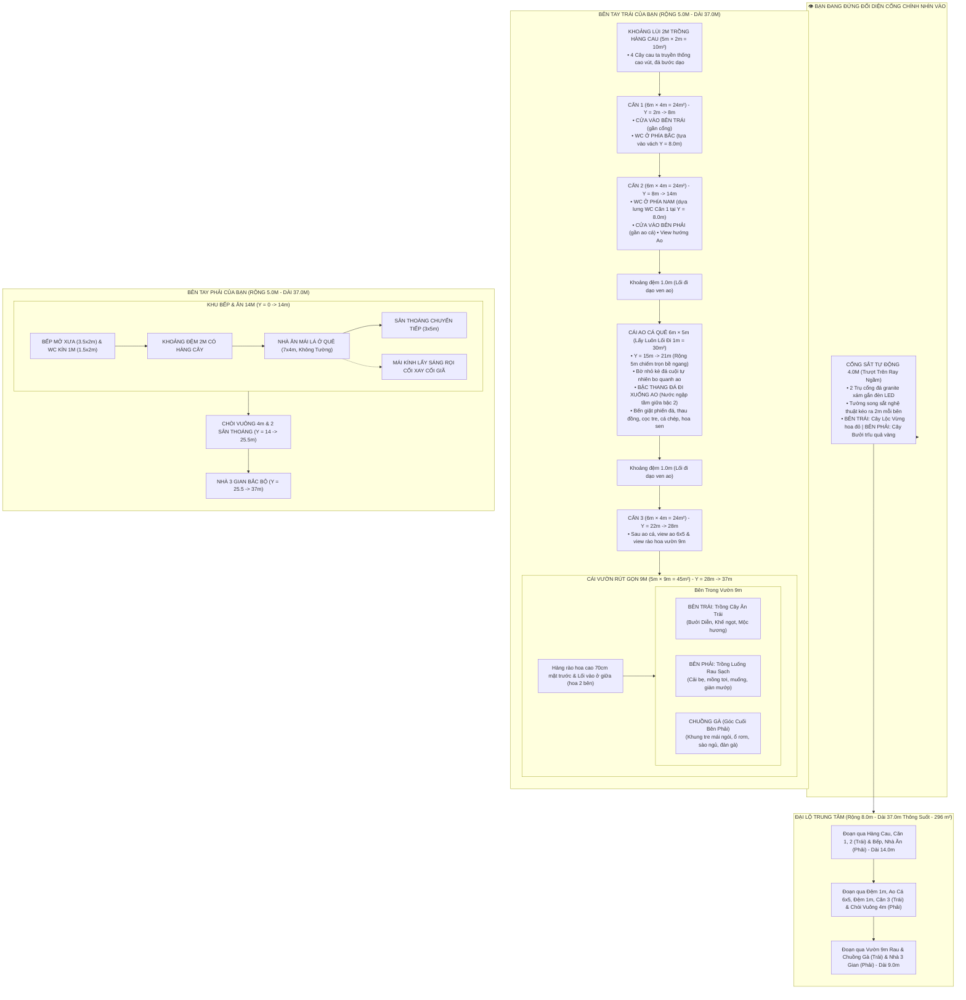

# BẢN THUYẾT MINH THIẾT KẾ QUY HOẠCH TOÀN DIỆN KHU NHÀ DÒNG HỌ
**Khuôn viên: 37.0m × 18.0m (Tổng diện tích: 666.0 m²)**
*Phiên bản quy hoạch cập nhật mới nhất: Cụm 2 Phòng 2 WC Dựa Lưng Nhau, Ao Cá 6x5 Bậc Thang Đá (Nước Ngập Giữa Bậc 2), Vườn 9m (Luống Rau & Chuồng Gà)*

---

## 1. TỔNG THỂ QUY HOẠCH VÀ HƯỚNG NHÌN

* **Vị trí đứng quan sát:** Người quan sát đứng ở **bên ngoài đối diện cổng chính nhìn thẳng vào khuôn viên**:
  * **Trục giữa & Mặt tiền Cổng Chính ($X \in [5.0, 13.0\text{m}]$):**
    * Đại lộ trung tâm rộng **8.0m**, thông suốt **37.0m** từ cổng vào đến hết đất.
    * **Cổng sắt tự động chạy qua chạy lại** rộng **4.0m** ($X \in [7.0, 11.0\text{m}]$) với ray trượt âm sàn ngầm, mô tơ tự động điều khiển từ xa và 2 trụ cổng ốp đá granite xám gắn đèn LED.
    * **Tường song sắt kéo ra 2.0m mỗi bên:** 
      * Đoạn 2m bên trái cổng ($X \in [5.0, 7.0\text{m}]$) và đoạn 2m bên phải cổng ($X \in [11.0, 13.0\text{m}]$).
      * Toàn bộ tường mặt trước bằng hệ song sắt nghệ thuật xen kẽ cây xanh thông thoáng.
    * **Cây phong thủy sau phần song sắt 2m:**
      * **Bên phải cổng:** Trồng **CÂY BƯỞI** Diễn trĩu quả tròn vàng óng, mang lại tài lộc thịnh vượng.
      * **Bên trái cổng:** Trồng **CÂY LỘC VỪNG** hoa đỏ buông rủ đón sinh khí may mắn.
  * **Bên tay trái của bạn (Dãy Trái - Rộng 5.0m, Dài 37.0m):**
    * **Khoảng lùi 2m ($Y = 0.0 \rightarrow 2.0\text{m}$):** Dãy nhà thụt vào 2m để trồng **HÀNG CAU TA** truyền thống thẳng tắp cao vút $4.0\text{m} - 4.4\text{m}$ ("trước cau sau chuối"), thảm cỏ xanh và đá bước dạo tự nhiên.
    * **Căn 1 (6×4, $Y = 2.0 \rightarrow 8.0\text{m}$):** Phòng gần cổng, **cửa vào bố trí ở bên trái** (phía gần cổng). **Nhà vệ sinh đặt ở phía Bắc**, tựa lưng vào tường $Y = 8.0\text{m}$.
    * **Căn 2 (6×4, $Y = 8.0 \rightarrow 14.0\text{m}$):** Phòng nối tiếp, **cửa vào bố trí ở bên phải** (phía gần ao). **Nhà vệ sinh đặt ở phía Nam**, tựa lưng vào tường $Y = 8.0\text{m}$.
      * 👉 **ĐẶC ĐIỂM ƯU VIỆT:** **2 NHÀ VỆ SINH CỦA CĂN 1 VÀ CĂN 2 DỰA LƯNG HOÀN TOÀN VÀO NHAU** tại vách ngăn chung $Y = 8.0\text{m}$, dùng chung hộp kỹ thuật cấp thoát nước, cực kỳ gọn gàng và chuẩn kiến trúc thi công!
    * **Khoảng cách 1m ($Y = 14.0 \rightarrow 15.0\text{m}$):** Lối đi dạo kết nối từ đại lộ 8m sang bờ ao cá.
    * **Cái Ao Cá Quê 6×5 ($Y = 15.0 \rightarrow 21.0\text{m}$, Rộng 5.0m = $30.0\text{ m}^2$):**
      * Mở rộng chiếm trọn bề ngang 5m (**lấy luôn lối đi 1m** sát tường rào ngoài).
      * Xóa bỏ cầu ao cũ, thay thế bằng **bờ nhỏ kè đá cuội tự nhiên** bo quanh ao.
      * **Bậc thang đá xanh nguyên khối đi xuống ao:** Nước ao dâng đến **tầm giữa bậc 2** giống hệt ao làng quê xưa!
      * Cọc tre vịn tay cắm lòng ao, phiến đá giặt phẳng nhẵn, thau đồng và chày gỗ đập vải giặt đồ xưa.
      * Đàn cá chép đồng (7 chú cá chép bạc, vàng, đỏ) bơi lội trong làn nước xanh biếc, hoa sen hoa súng thơm ngát.
    * **Khoảng cách 1m ($Y = 21.0 \rightarrow 22.0\text{m}$):** Lối đi dạo ven bờ Bắc của ao dẫn vào Căn 3.
    * **Căn 3 (6×4, $Y = 22.0 \rightarrow 28.0\text{m}$):** Nhà nghỉ biệt lập view ao cá phía Nam và view vườn hoa phía Bắc.
    * **Cái Vườn Cây Rút Gọn 9m ($Y = 28.0 \rightarrow 37.0\text{m}$, Rộng 5.0m = $45.0\text{ m}^2$):**
      * **Mặt trước vườn:** Hàng rào bụi hoa cao khoảng **70cm** xén tỉa gọn gàng, ở giữa có **đường đi vào vườn** lát đá sa thạch.
      * **Phần trước vườn:** Hai bên lối đi vào được trồng các bồn hoa rực rỡ sắc màu (hoa cúc, hoa hồng, mười giờ).
      * **Đứng từ lối vào nhìn vào vườn:**
        * **Bên phải (giáp đại lộ 8m):** **TRỒNG RAU SẠCH** (các luống rau cải, mồng tơi, rau muống và giàn mướp leo tre xanh tốt).
        * **Bên trái (giáp tường ngoài):** **TRỒNG CÂY ĂN TRÁI** (Bưởi Diễn trĩu quả vàng, Khế ngọt trĩu cành, Hoa Mộc Hương ngát hương).
        * **Cuối gần dãy tường bên phải vườn:** **CHUỒNG GÀ** quê truyền thống ($1.8\text{m} \times 2.2\text{m}$) khung tre gỗ mái ngói đỏ, lưới mắt cáo, ổ rơm đẻ trứng, sào tre đậu ngủ, máng ăn thóc và đàn gà trống thiến, gà mái mơ bới thóc sinh động.
  * **Bên tay phải của bạn (Dãy Phải - Rộng 5.0m, Dài 37.0m):**
    * **Khu đất 14m Bếp & Ăn ($Y = 0.0 \rightarrow 14.0\text{m}$):**
      * Khối WC kín (1.5m × 2m, cửa hướng nhà ăn) & Bếp mở dân dã (3.5m × 2m, bếp lò củi đất nung, nồi gang đúc).
      * Khoảng đệm 2m ($Y = 2.0 \rightarrow 4.0\text{m}$) hàng cây kiểng thanh lịch.
      * Nhà Ăn Mái Lá Ở Quê ($Y = 4.0 \rightarrow 11.0\text{m}$, Dài 7m × Rộng 4m, cột gỗ lim, không tường lộng gió).
      * Dải 1m thụt vào có MẶT KÍNH lấy sáng rọi Cối Xay Nan Tre & Cối Giã Gạo chân đạp.
      * Khoảng chuyển tiếp 3m ($Y = 11.0 \rightarrow 14.0\text{m}$) kết nối ra sân thoáng.
    * **Khu 2 ($Y = 14.0 \rightarrow 25.5\text{m}$):** Chòi Vuông 4m × 4m mái chồng diêm 2 tầng 4 mái đỉnh hồ lô vàng uy nghi cùng 2 khoảng sân thoáng đón gió.
    * **Khu 1 ($Y = 25.5 \rightarrow 37.0\text{m}$):** Nhà 3 Gian Bắc Bộ truyền thống thờ tổ tiên uy nghiêm, hè dài 9m sát đại lộ, cụm vườn hồng, chuối phong thủy và lối đi 1m.

---

## 2. SƠ ĐỒ MẶT BẰNG QUY HOẠCH CHI TIẾT (MERMAID)

---

## 3. BẢNG TỔNG HỢP KÍCH THƯỚC & TỌA ĐỘ TOÀN KHU

| STT | Phân Khu Công Năng | Kích thước ($D \times R$) | Tọa độ $Y$ | Tọa độ $X$ | Diện tích | Đặc điểm nổi bật |
| :---: | :--- | :---: | :---: | :---: | :---: | :--- |
| **0** | **Cổng Sắt Tự Động & Song Sắt** | $8.0\text{m} \times 2.3\text{m}$ | $Y = 0.0\text{m}$ | $5.0 \rightarrow 13.0\text{m}$ | $18.4\text{ m}^2$ | Cổng trượt 4m trên ray ngầm; Song sắt 2m trồng Cây Bưởi (phải) & Lộc Vừng (trái). |
| **1** | **Khoảng lùi Hàng Cau Ta** | $2.0\text{m} \times 5.0\text{m}$ | $0.0 \rightarrow 2.0\text{m}$ | $0.0 \rightarrow 5.0\text{m}$ | $10.0\text{ m}^2$ | Thụt vào 2m trồng 4 cây cau ta truyền thống thẳng tắp, đá bước dạo sa thạch. |
| **2** | **Căn 1 (Dãy Trái)** | $6.0\text{m} \times 4.0\text{m}$ | $2.0 \rightarrow 8.0\text{m}$ | $1.0 \rightarrow 5.0\text{m}$ | $24.0\text{ m}^2$ | **Cửa vào bên trái (gần cổng)**, **WC ở phía Bắc** tựa lưng vào vách $Y=8.0\text{m}$. |
| **3** | **Căn 2 (Dãy Trái)** | $6.0\text{m} \times 4.0\text{m}$ | $8.0 \rightarrow 14.0\text{m}$ | $1.0 \rightarrow 5.0\text{m}$ | $24.0\text{ m}^2$ | **WC ở phía Nam dựa lưng WC Căn 1**, **cửa vào bên phải (gần ao)**, view ao cá. |
| **4** | **Khoảng đệm 1** | $1.0\text{m} \times 5.0\text{m}$ | $14.0 \rightarrow 15.0\text{m}$ | $0.0 \rightarrow 5.0\text{m}$ | $5.0\text{ m}^2$ | Lối đi dạo kết nối đại lộ và bờ ao cá quê. |
| **5** | **Cái Ao Cá Quê 6×5** | $6.0\text{m} \times 5.0\text{m}$ | $15.0 \rightarrow 21.0\text{m}$ | $0.0 \rightarrow 5.0\text{m}$ | $30.0\text{ m}^2$ | **Lấy luôn lối đi 1m**, bờ nhỏ kè đá, **bậc thang đá nước ngập giữa bậc 2**, đàn cá chép, hoa sen, bến giặt xưa. |
| **6** | **Khoảng đệm 2** | $1.0\text{m} \times 5.0\text{m}$ | $21.0 \rightarrow 22.0\text{m}$ | $0.0 \rightarrow 5.0\text{m}$ | $5.0\text{ m}^2$ | Lối đi dạo ven bờ Bắc ao cá dẫn sang Căn 3. |
| **7** | **Căn 3 (Dãy Trái)** | $6.0\text{m} \times 4.0\text{m}$ | $22.0 \rightarrow 28.0\text{m}$ | $1.0 \rightarrow 5.0\text{m}$ | $24.0\text{ m}^2$ | Nhà nghỉ dưỡng biệt lập, view ao cá phía Nam và view hàng rào hoa phía Bắc. |
| **8** | **Cái Vườn Rút Gọn 9m** | $9.0\text{m} \times 5.0\text{m}$ | $28.0 \rightarrow 37.0\text{m}$ | $0.0 \rightarrow 5.0\text{m}$ | $45.0\text{ m}^2$ | Rào hoa 70cm mặt trước, lối vào giữa (hoa 2 bên); Bên phải trồng rau, bên trái trồng cây, cuối góc phải có chuồng gà. |
| **9** | **Chuồng Gà Quê** | $2.2\text{m} \times 1.8\text{m}$ | $34.6 \rightarrow 36.8\text{m}$ | $3.1 \rightarrow 4.9\text{m}$ | $4.0\text{ m}^2$ | Cuối gần tường bên phải vườn: cột tre mái ngói, lưới mắt cáo, ổ rơm trứng gà, máng ăn thóc, đàn gà trống mái. |
| **10** | **Khối Bếp & WC (Dãy Phải)** | $2.0\text{m} \times 5.0\text{m}$ | $0.0 \rightarrow 2.0\text{m}$ | $13.0 \rightarrow 18.0\text{m}$ | $10.0\text{ m}^2$ | Bếp mở dân dã lò củi 3.5m & WC kín 1.5m (cửa hướng nhà ăn). |
| **11** | **Khoảng đệm cây xanh 2m** | $2.0\text{m} \times 5.0\text{m}$ | $2.0 \rightarrow 4.0\text{m}$ | $13.0 \rightarrow 18.0\text{m}$ | $10.0\text{ m}^2$ | Hàng cây cảnh nhỏ tạo vùng đệm thoáng đãng. |
| **12** | **Nhà Ăn Mái Lá & Kính Kỷ Vật** | $7.0\text{m} \times 5.0\text{m}$ | $4.0 \rightarrow 11.0\text{m}$ | $13.0 \rightarrow 18.0\text{m}$ | $35.0\text{ m}^2$ | Nhà ăn mái lá 7x4m không tường + dải 1m có Mái Kính lấy sáng rọi Cối Xay & Cối Giã. |
| **13** | **Sân chuyển tiếp 3m** | $3.0\text{m} \times 5.0\text{m}$ | $11.0 \rightarrow 14.0\text{m}$ | $13.0 \rightarrow 18.0\text{m}$ | $15.0\text{ m}^2$ | Sân thoáng kết nối giữa Nhà Ăn và Chòi Vuông. |
| **14** | **Chòi Vuông 4m & Sân Thoáng** | $11.5\text{m} \times 5.0\text{m}$ | $14.0 \rightarrow 25.5\text{m}$ | $13.0 \rightarrow 18.0\text{m}$ | $57.5\text{ m}^2$ | Chòi vuông 4x4m mái chồng diêm đỉnh hồ lô vàng, 2 sân thoáng đón gió (đối diện ao cá 6x5!). |
| **15** | **Nhà 3 Gian Bắc Bộ** | $11.5\text{m} \times 5.0\text{m}$ | $25.5 \rightarrow 37.0\text{m}$ | $13.0 \rightarrow 18.0\text{m}$ | $57.5\text{ m}^2$ | Gian giữa thờ tổ uy nghiêm, gian tả trường kỷ, gian hữu sập gụ gia phả, vườn hồng, chuối và đường 1m. |
| **16** | **Đại Lộ Trung Tâm 8m** | $37.0\text{m} \times 8.0\text{m}$ | $0.0 \rightarrow 37.0\text{m}$ | $5.0 \rightarrow 13.0\text{m}$ | $296.0\text{ m}^2$ | Trục đường chính lát đá tự nhiên kết nối toàn khu. |
| **TỔNG**| **Toàn Khuôn Viên** | **$37.0\text{m} \times 18.0\text{m}$** | **$0.0 \rightarrow 37.0\text{m}$** | **$0.0 \rightarrow 18.0\text{m}$** | **$666.0\text{ m}^2$** | **Tổng diện tích đất chuẩn phong thủy gia tộc.** |
