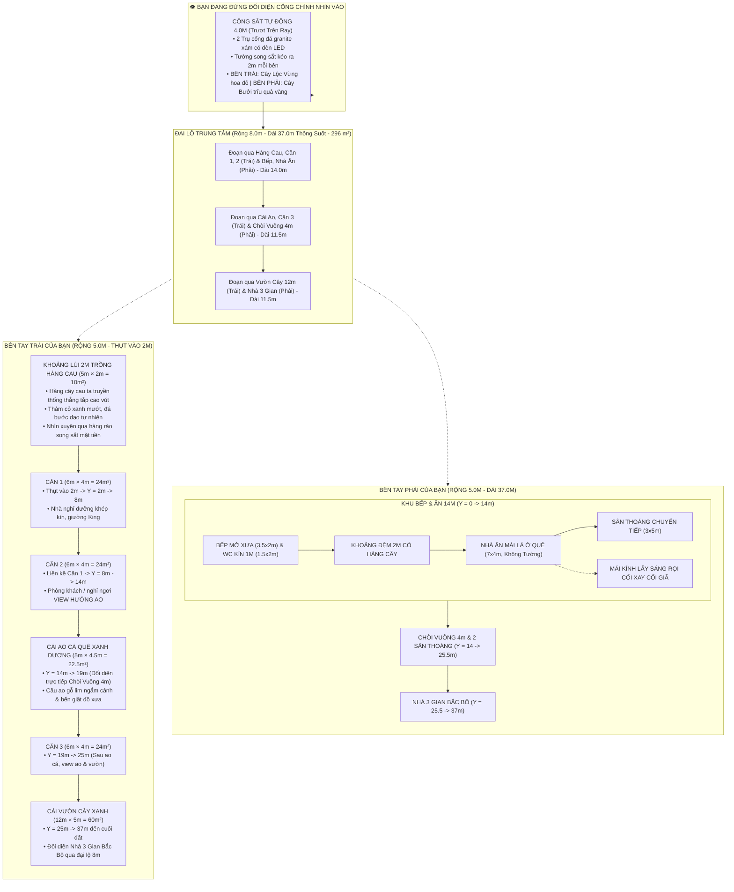

# BẢN THUYẾT MINH THIẾT KẾ QUY HOẠCH TOÀN DIỆN KHU NHÀ DÒNG HỌ
**Khuôn viên: 37.0m × 18.0m (Tổng diện tích: 666.0 m²)**
*Phiên bản quy hoạch cập nhật mới nhất: Cổng Sắt Tự Động 4m, Song Sắt Kéo Ra 2m, Cây Bưởi Phải & Lộc Vừng Trái, Khoảng Lùi 2m Trồng Hàng Cau, Dãy Trái Thụt Vào 2m*

---

## 1. TỔNG THỂ QUY HOẠCH VÀ HƯỚNG NHÌN

* **Vị trí đứng quan sát:** Người quan sát đứng ở **bên ngoài đối diện cổng chính nhìn thẳng vào khuôn viên**:
  * **Trục giữa & Mặt tiền Cổng Chính ($X \in [5.0, 13.0\text{m}]$):**
    * Đại lộ trung tâm vẫn giữ nguyên bề rộng **8.0m**, thông suốt **37.0m** từ cổng vào đến hết đất.
    * **Bỏ cổng to Tam Quan cũ**, thay bằng **CỔNG SẮT TỰ ĐỘNG CHẠY QUA CHẠY LẠI** rộng **4.0m** ($X \in [7.0, 11.0\text{m}]$) với ray trượt âm sàn, mô tơ tự động và 2 trụ cổng ốp đá granite xám gắn đèn LED.
    * **Tường song sắt kéo ra 2.0m mỗi bên:** 
      * Đoạn 2m bên trái cổng ($X \in [5.0, 7.0\text{m}]$) và đoạn 2m bên phải cổng ($X \in [11.0, 13.0\text{m}]$).
      * Toàn bộ tường mặt trước thiết kế hiện đại bằng **hệ song sắt nghệ thuật xen kẽ với cây xanh**.
    * **Cây trồng sau phần song sắt 2m:**
      * **Bên phải cổng:** Trồng **CÂY BƯỞI** Diễn trĩu quả tròn vàng óng, tỏa hương thơm ngát.
      * **Bên trái cổng:** Trồng **CÂY LỘC VỪNG** cổ thụ dáng huyền, chuỗi hoa đỏ thắm buông rủ đón vượng khí tài lộc.
  * **Bên tay trái của bạn (Dãy Trái - Rộng 5.0m, $X \in [0.0, 5.0\text{m}]$):**
    * **DÃY NHÀ BÊN TRÁI THỤT VÀO 2.0M tính từ tường cổng:**
      * **Khoảng lùi 2m ($Y = 0.0 \rightarrow 2.0\text{m}$):** Dành riêng để **TRỒNG HÀNG CÂY CAU** ta truyền thống thẳng tắp cao vút (nét văn hóa "trước cau, sau chuối"), thảm cỏ xanh và đá bước dạo tự nhiên.
      * **Căn 1 (6×4):** Thụt vào bắt đầu từ $Y = 2.0 \rightarrow 8.0\text{m}$ ($24\text{m}^2$).
      * **Căn 2 (6×4):** Xây liền kề Căn 1 từ $Y = 8.0 \rightarrow 14.0\text{m}$ ($24\text{m}^2$).
      * **Cái Ao Cá Quê Xanh Dương ($Y = 14.0 \rightarrow 19.0\text{m}$, dài $5.0\text{m}$):** Nằm đối diện trực tiếp Chòi Vuông 4x4 bên phải, có cầu ao gỗ lim ngắm cảnh và bến giặt đồ xưa.
      * **Căn 3 (6×4):** Nằm sau ao cá từ $Y = 19.0 \rightarrow 25.0\text{m}$ ($24\text{m}^2$).
      * **Cái Vườn Cây Xanh:** Chiếm toàn bộ phần còn lại từ $Y = 25.0 \rightarrow 37.0\text{m}$ (dài $12.0\text{m} \times$ rộng $5.0\text{m} = 60.0\text{ m}^2$).
  * **Bên tay phải của bạn (Dãy Phải - Rộng 5.0m, $X \in [13.0, 18.0\text{m}]$):**
    * **Khu đất 14m Bếp & Ăn ($Y = 0.0 \rightarrow 14.0\text{m}$):**
      * Khối WC (1.5m × 2m, xây kín phần thụt vào 1m, cửa hướng nhà ăn) & Bếp mở xưa (3.5m × 2m, bếp lò củi đất nung, nồi gang, mở toang về nhà ăn).
      * Khoảng đệm 2m ($Y = 2.0 \rightarrow 4.0\text{m}$) có hàng cây cảnh nhỏ dọc tường.
      * Nhà Ăn Mái Lá Ở Quê ($Y = 4.0 \rightarrow 11.0\text{m}$, Dài 7m × Rộng 4m, không tường lộng gió).
      * Dải 1m thụt vào có MẶT KÍNH nghiêng lấy sáng rọi Cối xay nan tre & Cối giã gạo cần đạp.
      * Khoảng chuyển tiếp 3m ($Y = 11.0 \rightarrow 14.0\text{m}$) sân thoáng cây cảnh.
    * **Khu 2 ($Y = 14.0 \rightarrow 25.5\text{m}$):** Chòi Vuông 4m × 4m mái chồng diêm 4 mái đỉnh hồ lô vàng.
    * **Khu 1 ($Y = 25.5 \rightarrow 37.0\text{m}$):** Nhà 3 Gian Bắc Bộ truyền thống đầy đủ nội thất.

---

## 2. BẢNG TỔNG HỢP KÍCH THƯỚC & DIỆN TÍCH (CHUẨN XÁC 100%)

| Khu Vực | Chiều Rộng ($X$) | Chiều Dài ($Y$) | Tọa Độ $Y$ (m) | Diện Tích Sàn / Mặt Nước | Đặc Điểm Kiến Trúc Cải Tạo |
| :--- | :---: | :---: | :---: | :---: | :--- |
| **CỔNG CHÍNH & MẶT TIỀN** | **18.0m** | **Tường rào** | $Y = 0.0$ | | **Cổng sắt tự động 4m** ở giữa, tường song sắt xen kẽ cây xanh kéo ra 2m mỗi bên |
| • Cổng Sắt Tự Động | 4.0m | Trượt ray | $X \in [7.0, 11.0]$ | | Cánh cổng sắt trượt tự động, mô tơ thông minh, 2 trụ đá granite có đèn LED |
| • Cây Lộc Vừng (Trái) | 2.0m | Sau song sắt | $Y \in [0.5, 2.5]$ | | Cây lộc vừng dáng huyền uốn lượn, chuỗi hoa đỏ rủ đón tài lộc đầu cổng |
| • Cây Bưởi (Phải) | 2.0m | Sau song sắt | $Y \in [0.5, 2.5]$ | | Cây bưởi Diễn trĩu quả tròn vàng óng xum xuê thơm ngát |
| **DÃY TRÁI (THỤT VÀO 2M)** | **5.0m** | **37.0m** | $0.0 \rightarrow 37.0$ | **185.0 m²** | **Khoảng lùi 2m trồng cau + 3 Căn 6x4 + Ao cá + Vườn 12m** |
| • Sân Hàng Cau Truyền Thống | 5.0m | 2.0m | $0.0 \rightarrow 2.0$ | 10.0 m² | **Hàng cau ta thẳng tắp cao vút**, thảm cỏ xanh, bồn đá viền |
| • Căn 1 (6x4) | 4.0m (+1m lùi) | 6.0m | $2.0 \rightarrow 8.0$ | 24.0 m² | Thụt vào 2m, nhà nghỉ dưỡng khép kín, giường King |
| • Căn 2 (6x4) | 4.0m (+1m lùi) | 6.0m | $8.0 \rightarrow 14.0$ | 24.0 m² | Liền kề Căn 1, phòng khách / nghỉ view hướng ao cá |
| • Cái Ao Cá Quê | 4.5m | 5.0m | $14.0 \rightarrow 19.0$ | 22.5 m² | Nước xanh dương, cầu ao ngắm cảnh, bến giặt đồ xưa |
| • Căn 3 (6x4) | 4.0m (+1m lùi) | 6.0m | $19.0 \rightarrow 25.0$ | 24.0 m² | Căn độc lập sau ao, view ao cá và tiếp giáp vườn cây |
| • Cái Vườn Cây Xanh | 5.0m | 12.0m | $25.0 \rightarrow 37.0$ | 60.0 m² | Cây ăn trái cổ truyền, thảm cỏ, lối dạo đá đến hết đất |
| **DÃY PHẢI (BẾP, ĂN, CHÒI, NHÀ 3 GIAN)** | **5.0m** | **37.0m** | $0.0 \rightarrow 37.0$ | **185.0 m²** | Bếp mở xưa, WC, Nhà ăn mái lá 7x4, Chòi vuông 4m, Nhà 3 gian |
| • Khối WC & Bếp Mở | 5.0m | 2.0m | $0.0 \rightarrow 2.0$ | 10.0 m² | WC (1.5x2m, xây kín 1m) + Bếp mở xưa (3.5x2m, lò củi đôi) |
| • Khoảng Đệm Hàng Cây | 5.0m | 2.0m | $2.0 \rightarrow 4.0$ | 10.0 m² | Sân đệm Bát Tràng, hàng cau kiểng/chuối cảnh dọc tường |
| • Nhà Ăn Mái Lá Ở Quê | 4.0m | 7.0m | $4.0 \rightarrow 11.0$ | 28.0 m² | Dạng mái lá quê, các cột gỗ lim xong mái lá, KHÔNG TƯỜNG |
| • Dải Kỷ Vật & MÁI KÍNH | 1.0m (ven tường) | 7.0m | $4.0 \rightarrow 11.0$ | 7.0 m² | Cối xay nan tre & Cối giã gạo, MẶT KÍNH nghiêng rọi nắng xuống |
| • Khoảng Chuyển Tiếp | 5.0m | 3.0m | $11.0 \rightarrow 14.0$ | 15.0 m² | Sân thoáng, bồn hoa và cây cảnh nhỏ trước Chòi Vuông 4m |
| • Chòi Vuông 4m & Sân | 4.0m | 11.5m | $14.0 \rightarrow 25.5$ | 46.0 m² | Chòi vuông 4x4m mái chồng diêm 4 mái đỉnh hồ lô vàng |
| • Nhà 3 Gian Bắc Bộ | 4.0m | 9.0m | $25.5 \rightarrow 34.5$ | 36.0 m² | Gỗ lim, án gian thếp vàng, sập gụ, trường kỷ, hè 9m |
| • Cụm Phụ Trợ & Đường 1m | 4.0m / 5.0m | 2.5m | $34.5 \rightarrow 37.0$ | 11.0 m² | Vườn hồng, bụi chuối, WC gia đình và đường nối thông hành |
| **TỔNG CỘNG** | **18.0m** | **37.0m** | | **666.0 m²** | **Khớp 100% diện tích và kích thước khuôn viên** |
