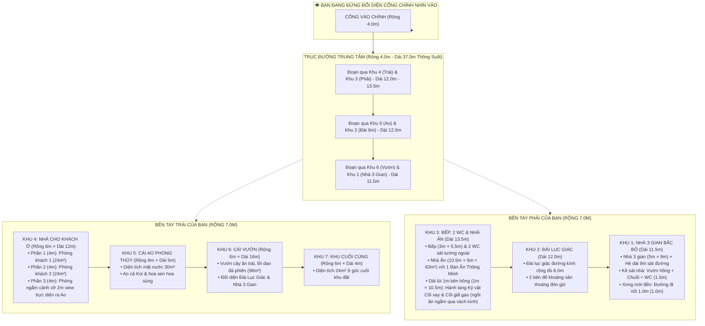

# BẢN THUYẾT MINH THIẾT KẾ QUY HOẠCH TOÀN DIỆN KHU NHÀ DÒNG HỌ
**Khuôn viên: 37.0m × 18.0m (Tổng diện tích: 666.0 m²)**
*Phiên bản hoàn thiện 100% hai dãy Tả - Hữu (7 Phân Khu: Khu 1 đến Khu 7)*

---

## 1. TỔNG THỂ QUY HOẠCH VÀ HƯỚNG NHÌN

* **Vị trí đứng quan sát:** Người quan sát đứng ở **bên ngoài đối diện cổng chính nhìn thẳng vào khuôn viên**:
  * **Trục giữa:** Đường chính rộng **4.0m**, kéo dài thông suốt **37.0m** từ cổng vào đến hết khu đất.
  * **Bên tay trái của bạn (Dãy Trái - Rộng 7.0m):** Đánh số từ cổng vào gồm **Khu 4 ➔ Khu 5 ➔ Khu 6 ➔ Khu 7**.
  * **Bên tay phải của bạn (Dãy Phải - Rộng 7.0m):** Đánh số gồm **Khu 3 ➔ Khu 2 ➔ Khu 1**.
  * **Quy chuẩn khoảng lùi:** Tất cả các công trình xây dựng hai bên đều thụt vào **$1.0\text{m}$** so với tường bao ngoài ranh đất (chiều rộng xây dựng hữu dụng là **$6.0\text{m}$**; riêng 2 WC Khu 3 được xây trực tiếp trên dải 1m sát tường theo chỉ đạo gia chủ).



---

## 2. CHI TIẾT THIẾT KẾ DÃY BÊN TRÁI (KHU 4, 5, 6, 7)

### 2.1. Khu 4: Nhà Khách Nghỉ Dưỡng Gia Tộc (Rộng 6.0m × Dài 12.0m = $72.0\text{ m}^2$)
* **Vị trí:** Nằm ngay phía cổng bên tay trái, thuận tiện đón tiếp bạn bè, bà con các chi họ ở xa về thăm quê, nghỉ lại qua đêm.
* **Mặt bằng công năng chuẩn biệt thự nghỉ dưỡng truyền thống:**
  1. **Hành lang nội bộ kết nối (Rộng $1.26\text{m}$, Dài $8.0\text{m}$, $X = 5.56 \rightarrow 6.82$):**
     * Chạy dọc bên phải Nhà Khách (giáp trục đường 4m), kết nối từ cửa chính vào các phòng ngủ và dẫn thẳng ra đại sảnh phòng khách ngắm ao cá.
     * Tường hành lang dày $0.12\text{m}$ ngăn cách với các phòng ngủ, trổ 2 cửa đi riêng biệt có khuôn bao gỗ và cánh cửa gỗ tự nhiên mở hé $35^\circ$ kèm tay nắm kim loại sang trọng.
     * Trần hành lang bố trí đèn downlight ấm áp và tranh ảnh phong cảnh quê hương.
  2. **Phòng ngủ Master 1 ($Y = 0.18 \rightarrow 3.94$, Diện tích $16.5\text{ m}^2$):**
     * Phòng ngủ khép kín độc lập, có tường ngăn cách âm và cửa đi riêng biệt mở từ hành lang.
     * Bố trí giường King-size ($1.8\text{m} \times 2.0\text{m}$), 2 tab đầu giường có đèn ngủ, tủ áo cao kịch trần, bàn làm việc, TV treo tường.
     * Phòng tắm/WC khép kín riêng biệt ($1.5\text{m} \times 1.9\text{m}$): buồng tắm đứng vách kính cường lực, vòi sen crom, lavabo mặt đá marble đen, bồn cầu sứ cao cấp.
  3. **Phòng ngủ Khách 2 ($Y = 4.06 \rightarrow 7.94$, Diện tích $16.5\text{ m}^2$):**
     * Phòng ngủ khép kín độc lập, có tường ngăn và cửa đi riêng biệt mở từ hành lang.
     * Bố trí 2 giường đơn (Twin beds $1.1\text{m} \times 2.0\text{m}$) tiện lợi cho con cháu/khách quý, tab đầu giường, tủ áo, kệ hành lý và TV.
     * Phòng tắm/WC khép kín riêng biệt đầy đủ tiện nghi cao cấp.
  4. **Đại sảnh Phòng Khách Mở Thông & Ngắm Ao Cá ($Y = 8.00 \rightarrow 12.00$, Diện tích $22.5\text{ m}^2$):**
     * **Không gian mở hoàn toàn:** Bức tường hành lang kết thúc hoàn toàn tại $Y = 8.00$, hành lang mở toang $100\%$ hòa nhập vào toàn bộ bề rộng $5.64\text{m}$ của căn nhà tạo thành một phòng khách gia đình khoáng đạt, ấm cúng như phòng khách trong nhà.
     * **Quầy tiện ích Mini-Pantry & Bar trà (góc sau bên trái):** Tủ gỗ tự nhiên, mặt đá marble đen, tủ lạnh mini để nước ngọt/trái cây, ấm đun siêu tốc, giá treo ly cốc pha trà cà phê.
     * **Bộ bàn ghế phòng khách sang trọng:** Bộ trường kỷ / sofa văng gỗ tự nhiên dài $2.6\text{m}$ đệm nỉ êm ái kèm gối tựa (ngồi nhìn thẳng ra ao cá), bàn trà me tây nguyên tấm, bộ ấm chén Bát Tràng truyền thống, 2 ghế bành armchair thư giãn, thảm trải sàn dệt họa tiết trang nhã và kệ trang trí bonsai mini.
     * **Vách kính Panorama kịch trần ($Y = 12.0\text{m}$, rộng $5.64\text{m} \times$ cao $3.15\text{m}$):** Mở tầm nhìn tuyệt đối không giới hạn ra mặt nước ao cá, ngắm hoa sen bồng bềnh và đàn cá chép đồng bơi lội ngay trước mắt.

---

### 2.2. Khu 5: Cái Ao Cá Phong Thủy (Rộng 6.0m × Dài 5.0m = $30.0\text{ m}^2$)
* **Vị trí:** Nằm kế bên Nhà Khách Khu 4, tạo thế "thủy bao" tụ tài tích lộc.
* **Cảnh quan sinh thái:**
  * Bờ ao kè đá cuội tự nhiên bo tròn mềm mại, mộc mạc.
  * Mặt nước trong xanh mát, thả cá ao quê truyền thống (cá chép đồng ánh bạc, cá chép vàng, cá chép đỏ) bơi lội thanh bình.
  * Điểm xuyết hoa súng, hoa sen tỏa hương thơm ngát và cầu ao ván gỗ lim mộc mạc bắc ra mép nước.
  * Giúp hạ nhiệt độ, mang làn gió mát lành thổi vào phòng ngắm cảnh 2m của Khu 4 và trục đường chính.

---

### 2.3. Khu 6: Cái Vườn Cây (Rộng 6.0m × Dài 16.0m = $96.0\text{ m}^2$)
* **Vị trí:** Nằm kế bên Ao Khu 5, chiếm trọn vẹn chiều dài **$16.0\text{m}$** ở khoảng giữa và cuối dãy trái.
* **Tương quan đối xứng qua trục đường 4.0m:**
  * Nằm đối diện trực tiếp với **Đài Lục Giác Khu 2** và **Nhà 3 Gian Khu 1**.
  * Khi gia đình ngồi tại Đài Lục Giác thưởng trà hay đứng trên hè Nhà 3 gian nhìn sang, toàn bộ tầm mắt là một khoảng không gian xanh ngút ngàn, mát dịu.
* **Quy hoạch cảnh quan:**
  * Trồng các loại cây ăn trái lâu năm của Bắc Bộ: Bưởi Diễn, khế ngọt, cam chanh, hoa mộc hương thơm ngát.
  * Lối dạo lát đá phiến tự nhiên quanh co trên thảm cỏ nhung.

---

### 2.4. Khu 7: Khu Cuối Cùng (Rộng 6.0m × Dài 4.0m = $24.0\text{ m}^2$)
* **Vị trí:** Tọa lạc tại góc cuối cùng của khu đất bên tay trái.
* **Đặc điểm:** Không gian yên tĩnh, vuông vắn ($24\text{ m}^2$).
* **Đề xuất công năng:** Quỹ đất dự trữ (chờ gia chủ chỉ định sau).

---

### 2.5. Bố Trí Cụm Kỷ Vật Cổ Truyền (Cối Xay Thóc & Cối Giã Gạo) Tại Dãy Phải (Khu 3)
* **Vị trí bố trí chính thức:** Nằm trong **dải đất thụt lùi rộng $1.0\text{m}$, dài $10.5\text{m}$ ($10.5\text{ m}^2$)** nằm ngay bên hông Nhà Ăn Gia Tộc (giữa tường nhà ăn và tường bao ngoài ranh đất).
* **Mục đích & Trải nghiệm kiến trúc:**
  * Toàn bộ mảng tường ngăn cách giữa Nhà Ăn và Dải lùi 1.0m này được thiết kế bằng **hệ vách kính cường lực lớn sát sàn (hoặc cửa kính trượt âm tường)**.
  * Khi con cháu, gia đình quây quần dùng bữa hoặc đãi tiệc đại gia tộc bên chiếc **Bàn Ăn Thông Minh**, mọi người có thể vừa thưởng thức ẩm thực, vừa phóng tầm mắt qua vách kính ngắm nhìn trọn vẹn cụm hiện vật xưa:
    1. **Cối xay thóc cổ truyền Bắc Bộ:** Đan bằng nan tre bọc đất nện, có cần giằng xay lúa mộc mạc (theo ảnh tham chiếu gia chủ gửi).
    2. **Cối giã gạo bằng cần đạp chân xưa:** Thân cần bập bênh bằng gỗ nghiến/lim, cối đá xanh nguyên khối, chày gỗ và bàn đạp chân ở đuôi cần.
  * **Cảnh quan phụ trợ:** Nền hành lang rải sỏi cuội trắng suối tự nhiên, điểm xuyết vài bụi trúc quân tử nhỏ và đèn spotlight hắt sáng ấm áp ban đêm, tạo nên một không gian 'bảo tàng mini ngoài trời' sống động, hoài niệm và tràn ngập ý nghĩa gắn kết cội nguồn.

---

### 2.6. Chi Tiết Thiết Kế Nội Thất Nhà 3 Gian Truyền Thống Bắc Bộ (Khu 1)
* **Quy cách kiến trúc:** Nhà gỗ truyền thống 3 gian cổ truyền ($9.0\text{m} \times 5.0\text{m} = 45.0\text{m}^2$), mái ngói mũi hài Bát Tràng, kìm nóc, bờ nóc đắp dải hoa chanh, 4 hàng cột gỗ lim kê chân tảng đá xanh hoa sen bồng, hệ cửa bức bàn "thượng song hạ bản" 3 gian mở rộng.
* **Bố trí nội thất chuẩn mực phong thủy cổ truyền Bắc Bộ:**
  1. **Gian Giữa (Thờ Tổ Uy Nghiêm & Linh Thiêng):**
     * **Án gian thờ gỗ gụ sơn son thếp vàng 9999:** Kích thước đại ($1.97\text{m} \times 1.07\text{m} \times 1.27\text{m}$), chạm lộng lưỡng long chầu nguyệt, chân quỳ chạm nghê vững chãi.
     * **Ngai thờ tổ tiên:** Đặt chính giữa tầng cao của án gian, chạm trổ sơn son thếp vàng trang trọng.
     * **Bộ Ngũ sự bằng đồng hun cổ truyền:** Gồm 1 đỉnh trầm chạm lộng hình lân ngậm ngọc, 2 cây đèn chân nến trổ hoa văn cổ, 2 tượng hạc ngậm cành sen chầu trên lưng rùa đá.
     * **Cửa võng tứ linh thếp vàng:** Treo võng trang trọng trước án gian, điêu khắc long - lân - quy - phụng dát vàng lộng lẫy.
     * **Hoành phi - Câu đối lòng máng:** Bức đại tự hoành phi sơn then chữ vàng **"Đức Lưu Quang" (德流光)** treo chính giữa bờ xà; hai bên cột cái ốp đôi câu đối lòng máng chạm rồng mạ vàng nhắc nhở đạo lý cội nguồn "Uống nước nhớ nguồn".
     * **Đôi Lục bình gốm men lam Bát Tràng:** Đặt hai bên án gian, cao $1.8\text{m}$ vẽ tích chim công khổng tước phú quý uy nghi.
     * **Bàn tiền dâng lễ & Chiếu cói hoa:** Phía trước đặt bàn tiền nhỏ để con cháu dâng mâm hoa quả lễ vật, sàn trải đôi chiếu cói hoa dệt thủ công làng nghề truyền thống.
  2. **Gian Tả (Bên Trái - Tiếp Đón Trọng Thể & Thưởng Trà):**
     * **Bộ Trường kỷ gỗ gụ/lim chạm cườm cổ kính:** Gồm 1 ghế dài văng, 2 ghế đơn tựa lưng chạm hạt cườm bóng loáng theo phong cách Bắc Bộ xưa, 1 bàn trà dài thanh thoát.
     * **Đồ dùng trà đạo dân dã:** Bộ ấm chén gốm mộc Bát Tràng tráng men lam, đĩa đựng trầu cau và ống điếu bát thuốc lào men ngọc bọc đồng xưa.
     * **Tủ chè gỗ gụ khảm ốc xà cừ ngũ sắc:** Đặt sát vách hậu, cánh khảm ốc xà cừ tích Tứ quý / Tam quốc, bên trên bày tượng Tam Đa Phúc - Lộc - Thọ bằng gốm sứ.
     * **Tranh Tứ bình:** Bộ tranh gỗ/sứ chạm 4 mùa Xuân - Hạ - Thu - Đông mang sinh khí hanh thông quanh năm.
  3. **Gian Hữu (Bên Phải - Tĩnh Dưỡng & Lưu Giữ Gia Phả Dòng Họ):**
     * **Sập gụ đại ba thành chạm Ngũ Phúc Lâm Môn:** Kích thước lớn ($1.8\text{m} \times 2.2\text{m}$), mặt sập nguyên tấm đánh bóng sáp ong lộ vân gỗ lim/gụ tự nhiên, thành sập chạm trổ tích 5 con dơi ngậm chữ Thọ mang lại bình an, trường thọ cho gia tộc.
     * **Gối xếp gấm đỏ truyền thống:** Gối xếp nhiều nấc dệt gấm đỏ hoa cúc kim tuyến để các bậc trưởng lão tựa lưng nghỉ ngơi, hàn huyên.
     * **Bàn cờ tướng chân quỳ thấp:** Đặt ngay trên sập gụ để các cụ đàm đạo chơi cờ ngâm thơ ngày tế tổ.
     * **Tủ kính gia phả dòng họ:** Tủ gỗ hương kính cường lực trang trọng lưu giữ cuốn gia phả tổ tiên truyền đời, sắc phong và bằng khen của dòng tộc.
     * **Bức thư pháp đại tự:** Khung gỗ kính treo đại tự **"Tổ Đức Trường Tồn" (祖德長存)** bằng chữ Hán - Quốc ngữ uy phong.
  4. **Ánh sáng & Khung nhà gỗ:**
     * Hệ thống đèn lồng gỗ lục giác lụa gấm treo từ câu đầu, tỏa ánh sáng vàng $2700\text{K}$ ấm áp, linh thiêng, giữ trọn vẹn hồn cốt nhà gỗ cổ truyền Việt Nam.

---

## 3. TỔNG HỢP TOÀN BỘ 7 PHÂN KHU TOÀN KHU ĐẤT (37.0M × 18.0M)

| Dãy | Khu | Hạng Mục Công Trình | Kích Thước (Dài × Rộng) | Diện Tích Sàn | Công Năng & Đặc Điểm Kiến Trúc |
|:---:|:---:|:---|:---:|:---:|:---|
| **TRÁI** | **Khu 4** | **Nhà Cho Khách Ở** | $12.0\text{m} \times 6.0\text{m}$ | $\mathbf{72.0\text{ m}^2}$ | 3 phần $\times 4\text{m}$ (2 phòng ngủ Master khép kín có WC riêng + sảnh pantry + phòng ngắm cảnh 2m sát ao) |
| **TRÁI** | **Khu 5** | **Cái Ao Cá Quê** | $5.0\text{m} \times 6.0\text{m}$ | $\mathbf{30.0\text{ m}^2}$ | Ao cá bình thường vườn quê, kè bờ đá cuội, cá chép đồng, hoa sen, hoa súng, cầu ao gỗ |
| **TRÁI** | **Khu 6** | **Cái Vườn Cây** | $16.0\text{m} \times 6.0\text{m}$ | $\mathbf{96.0\text{ m}^2}$ | Vườn ăn trái, thảm cỏ, đối diện Đài Lục Giác & Nhà 3 Gian |
| **TRÁI** | **Khu 7** | **Khu Cuối Đất** | $4.0\text{m} \times 6.0\text{m}$ | $\mathbf{24.0\text{ m}^2}$ | Góc cuối yên tĩnh (kho đồ / kỹ thuật / chòi ngơi) |
| **GIỮA** | **Trục Chính**| **Đường Giao Thông 4m** | $37.0\text{m} \times 4.0\text{m}$ | $\mathbf{148.0\text{ m}^2}$ | Trục thần đạo xuyên suốt từ cổng vào đến cuối đất |
| **PHẢI** | **Khu 3** | **Bếp Nấu (Phía cổng)** | $3.0\text{m} \times 5.5\text{m}$ | $\mathbf{16.5\text{ m}^2}$ | Bếp inox 3 họng ga, bàn đảo soạn cỗ, cửa thông nhà ăn |
| **PHẢI** | **Khu 3** | **2 WC (Sát tường ngoài)**| $3.0\text{m} \times 1.5\text{m}$ | $\mathbf{4.5\text{ m}^2}$ | Xây trực tiếp sát tường rào trên dải 1m, 2 buồng riêng |
| **PHẢI** | **Khu 3** | **Nhà Ăn Gia Tộc** | $10.5\text{m} \times 6.0\text{m}$ | $\mathbf{63.0\text{ m}^2}$ | **1 Bàn ăn thông minh biến hình**, vách kính nhìn sang dải lùi 1m |
| **PHẢI** | **Khu 3** | **Hành Lang Kỷ Vật Xưa** | $10.5\text{m} \times 1.0\text{m}$ | $\mathbf{10.5\text{ m}^2}$ | **Trưng bày Cối Xay Thóc & Cối Giã Gạo** để ngồi ăn ngắm qua kính |
| **PHẢI** | **Khu 2** | **Đài Lục Giác** | Đường kính $6.0\text{m}$ | $\mathbf{27.5\text{ m}^2}$ | Phủ trọn 6m ngang đất, 2 bên sân thoáng đãng |
| **PHẢI** | **Khu 1** | **Nhà 3 Gian Bắc Bộ** | $9.0\text{m} \times 5.0\text{m}$ | $\mathbf{45.0\text{ m}^2}$ | 3 gian cửa bức bàn, cột gỗ trên tảng đá xanh, ngói đỏ |
| **PHẢI** | **Khu 1** | Cái Hè sát đường | $9.0\text{m} \times 1.0\text{m}$ | $\mathbf{9.0\text{ m}^2}$ | Hàng cột hiên và bậc tam cấp chạy suốt 9m |
| **PHẢI** | **Khu 1** | Cụm Vườn hồng, chuối, WC | $1.5\text{m} \times 6.0\text{m}$ | $\mathbf{9.0\text{ m}^2}$ | Kế sát nhà: cảnh quan phong thủy và vệ sinh khép kín |
| **PHẢI** | **Khu 1** | Đường đi nối 1.0m | $1.0\text{m} \times 6.0\text{m}$ | $\mathbf{6.0\text{ m}^2}$ | Nằm sau cụm vườn/WC, nối dải lùi ra đường chính |

* **Kiểm tra diện tích & kích thước toàn khu đất:**
  * Bề rộng: $\text{Dãy Trái }(7\text{m}) + \text{Đường }(4\text{m}) + \text{Dãy Phải }(7\text{m}) = \mathbf{18.0\text{m}}$.
  * Chiều dài Dãy Trái: $12\text{m (Khu 4)} + 5\text{m (Khu 5)} + 16\text{m (Khu 6)} + 4\text{m (Khu 7)} = \mathbf{37.0\text{m}}$.
  * Chiều dài Dãy Phải: $13.5\text{m (Khu 3)} + 12\text{m (Khu 2)} + 11.5\text{m (Khu 1)} = \mathbf{37.0\text{m}}$.
  * Khớp chuẩn 100% không dư thiếu một phân nào!

---

## 4. HÌNH ẢNH MÔ PHỎNG 3D THỰC THỂ (OPENSCAD 3D RENDERS)

Mô hình 3D thực thể đã được lập trình hoàn chỉnh bằng mã nguồn OpenSCAD lưu tại [khu_nha_dong_ho.scad](file:///d:/Work/khu_nha_dong_ho.scad). Dưới đây là các góc nhìn phối cảnh 3D độ phân giải cao được kết xuất trực tiếp từ mô hình:

### 4.1. Phối cảnh tổng thể khuôn viên 37m × 18m (Có mái)


### 4.2. Mặt bằng nội thất 3D (Bỏ mái để kiểm tra công năng)


### 4.3. Cận cảnh Hành Lang Kỷ Vật Xưa (Cối Xay Thóc & Cối Giã Gạo trong dải lùi 1m)


### 4.4. Cận cảnh Nhà 3 Gian Bắc Bộ (Khu 1) & Cái Hè 9m sát đường


---

---

## 4. BỘ HÌNH ẢNH RENDER 3D CHUYÊN NGHIỆP TỪ BLENDER 4.2 LTS (CYCLES RAYTRACING)

Nhằm khắc phục hoàn toàn nhược điểm "nhựa nhựa" của OpenSCAD và mang lại độ chân thực kiến trúc chuẩn công trình thực tế, toàn bộ khuôn viên đã được mô phỏng lại trong **Blender 4.2.0 LTS** với:
* **Vật liệu PBR thực tế:** Ngói đỏ đất nung Bát Tràng, gỗ lim Lào sẫm, đá xanh Thanh Hóa, đá bazan lát đường, kính cường lực trong suốt phản xạ, mặt nước ao cá khúc xạ, thếp vàng 9999 bàn thờ tổ.
* **Hệ thống ánh sáng tự nhiên:** Ánh nắng mặt trời góc 50° đổ bóng viền mềm, bầu trời tán xạ thực tế và hệ thống đèn nội thất ấm cúng bên trong các gian nhà.
* **Mã nguồn tự động hóa:** [khu_nha_dong_ho_blender.py](file:///d:/Work/khu_nha_dong_ho_blender.py)
* **Tệp dự án Blender (.blend) sẵn sàng mở bằng GUI:** [khu_nha_dong_ho.blend](file:///d:/Work/khu_nha_dong_ho.blend)

````carousel

<!-- slide -->

<!-- slide -->

<!-- slide -->

<!-- slide -->

<!-- slide -->

<!-- slide -->

<!-- slide -->

<!-- slide -->

<!-- slide -->

<!-- slide -->

<!-- slide -->

````

### 4.1. Phối cảnh bóc mái (Cutaway View) - Thấy trọn vẹn cả 2 khu Nhà Khách và Nhà 3 Gian

* *Ghi chú:* Bóc dỡ toàn bộ hệ mái để kiểm tra công năng: Dãy Trái thấy rõ hành lang 1.26m, 2 phòng ngủ khép kín với cửa mở $35^\circ$, đại sảnh phòng khách thông suốt ra ao cá; Dãy Phải thấy trọn vẹn 3 gian Nhà Thờ Tổ với án gian thờ thếp vàng, đôi lục bình, bộ trường kỷ tiếp khách và sập gụ đại.

### 4.2. Phối cảnh nội bộ Hành Lang Nhà Khách (Góc nhìn người đi từ cửa vào)

* *Ghi chú:* Đứng tại cửa chính nhìn dọc hành lang: bên trái là tranh nghệ thuật và 2 cánh cửa phòng ngủ riêng biệt có khuôn bao và tay nắm; phía cuối hành lang mở toang thông suốt vào đại sảnh phòng khách ngắm đàn cá bơi lội trong ao xanh mát.

### 4.3. Từ đại sảnh phòng khách nhìn ra Ao Cá quê (Khu 4 ➔ Khu 5)

* *Ghi chú:* Ngồi tại bộ bàn ghế sofa gỗ tự nhiên sang trọng, trên bàn là khay trà gốm mộc Bát Tràng, phóng tầm mắt qua vách kính panorama kịch trần ngắm trọn vẹn ao cá trong xanh, đàn cá chép đồng bơi lội, cầu ao gỗ lim và rặng cây xanh mướt.

### 4.4. Từ phòng ăn nhìn sang Hành lang Kỷ vật Xưa (Khu 3)

* *Ghi chú:* Bàn ăn dài trong phòng ăn, vách kính cường lực trong suốt phản xạ mềm mại, bên ngoài là cối xay thóc nan tre bọc đất nện, cối giã gạo cần đạp chân gỗ lim chữ Y, rặng trúc quân tử và nền rải sỏi trắng cuội có đèn rọi ấm áp.

### 4.5. Phối cảnh Đài Lục Giác 6.0m & Nhà 3 Gian Bắc Bộ (Khu 2 & Khu 1)

* *Ghi chú:* Đài lục giác mái chồng diêm 2 tầng lợp ngói đỏ, đắp đỉnh hồ lô thếp vàng, 6 cột gỗ lim trên bệ đá xanh; kế bên là Nhà 3 gian với hè dài 9m, chân tảng hoa sen bồng và 3 bộ cửa bức bàn.

### 4.6. Phối cảnh từ Cổng Tam Quan mở rộng nhìn vào

* *Ghi chú:* Cột biểu đá xanh, xà ngang gỗ lim, hoành phi thếp vàng, đôi cánh cổng gỗ lim mở rộng nhìn sâu vào trục đường chính 4m thẳng tắp có trụ đèn đá dẫn lối.

### 4.7. Cận cảnh Nội Thất Nhà 3 Gian Bắc Bộ (Thờ Tự & Tiếp Khách Truyền Thống)

* *Ghi chú:* Đứng từ bậc thềm nhìn xuyên qua cửa bức bàn vào trong:
  * **Gian giữa:** Bàn thờ Án gian sơn son thếp vàng 9999 rực rỡ, ngai thờ tổ, bộ ngũ sự đồng cổ (đỉnh đồng, chân nến, hạc chầu), cửa võng tứ linh thếp vàng chạm trổ công phu, hoành phi "Đức Lưu Quang", câu đối lòng máng chạm rồng, đôi lục bình men lam $1.8\text{m}$ và bàn tiền trải chiếu cói hoa.
  * **Gian tả (trái):** Bộ trường kỷ gỗ lim chạm cườm, khay trà ấm chén Bát Tràng, điếu bát, tủ chè khảm ốc xà cừ ngũ sắc và tranh tứ bình 4 mùa.
  * **Gian hữu (phải):** Sập gụ đại ba thành chạm ngũ phúc, gối xếp gấm đỏ, bàn cờ tướng và tủ kính lưu giữ gia phả dòng họ.

### 4.8. Phối Cảnh Hướng Nam (Nhìn Từ Cổng Chính Vào Toàn Bộ Khuôn Viên)

* *Ghi chú:* Góc nhìn từ phía Nam (trên cao cổng vào): Bao quát toàn bộ chiều dài 37m, trục đường 4m ở giữa, hai dãy công trình Tả - Hữu đối xứng chuẩn mực, mái ngói đỏ Bát Tràng nổi bật trên nền cây xanh sân vườn.

### 4.9. Phối Cảnh Hướng Bắc (Nhìn Từ Cuối Đất Hướng Ngược Về Cổng)

* *Ghi chú:* Đứng từ phía Bắc (sau lưng Nhà 3 Gian và Khu 7) nhìn bao quát ngược về phía cổng: Thấy rõ khối công trình Nhà 3 Gian uy nghi, khoảng sân vườn, đài lục giác, ao cá và cổng tam quan mở rộng ở xa xa.

### 4.10. Phối Cảnh Hướng Đông (Nhìn Từ Dãy Phải Sang Dãy Trái)

* *Ghi chú:* Góc nhìn bao quát toàn bộ Dãy Trái từ trên cao Dãy Phải: Thấy rõ Nhà Khách $12\text{m}$, Ao cá vườn quê $5\text{m}$, Vườn cây xanh mát $16\text{m}$ và Khu 7 ở góc cuối.

### 4.11. Phối Cảnh Hướng Tây (Nhìn Từ Dãy Trái Sang Dãy Phải)

* *Ghi chú:* Góc nhìn bao quát toàn bộ Dãy Phải từ trên cao Dãy Trái: Thấy rõ khối Bếp & 2 WC sát tường, Nhà Ăn Gia Tộc với dải lùi kỷ vật 1m, Đài Lục Giác $6\text{m}$ mái chồng diêm cùng 2 khoảng sân thoáng đón gió, và Nhà 3 Gian Bắc Bộ ở cuối dãy.

---

## 5. MÔ HÌNH 3D XOAY 360° TRỰC TIẾP TRÊN TRÌNH DUYỆT (HTML WEBGL THREE.JS)

Toàn bộ mô hình 3D thực thể khuôn viên $37.0\text{m} \times 18.0\text{m}$ hiện đã được tích hợp trực tiếp vào tệp ứng dụng web **[khu_nha_dong_ho_simulator.html](file:///d:/Work/Khu_Nha_Dong_Ho/khu_nha_dong_ho_simulator.html)** bằng công nghệ **Three.js WebGL**, cho phép bạn mở bằng bất kỳ trình duyệt nào (Chrome, Edge, Cốc Cốc, Safari) để tương tác trực tiếp mà không cần cài đặt phần mềm:

### Các tính năng tương tác 3D nổi bật:
1. **Xoay 360° tự do (3D Orbit):**
   * **Chuột trái / Chạm 1 ngón tay:** Giữ và rê chuột để xoay 360° quanh khu đất theo mọi phương ngang, dọc.
   * **Chuột phải / Chạm 2 ngón tay:** Giữ và rê chuột để tịnh tiến (pan) khung nhìn.
   * **Con lăn chuột / Pinch:** Phóng to (zoom in) tận mắt vào từng góc nhà, phòng ngủ hoặc thu nhỏ (zoom out) toàn cảnh.
2. **Nút Bóc Mái (Cutaway Mode) tức thì:**
   * Chỉ với 1 click vào nút `[🏠 Bóc Mái (Xem Bên Trong)]`, toàn bộ hệ thống mái ngói sẽ ẩn đi ngay lập tức, để lộ thấu suốt bên trong:
     * Hành lang nội bộ $1.26\text{m}$, 2 phòng ngủ khép kín với cửa mở $35^\circ$, giường tủ, bàn làm việc, phòng tắm riêng.
     * Đại sảnh phòng khách mở toang ngắm ao cá qua vách kính, bộ sofa gỗ, bàn trà me tây, quầy pantry.
     * Ao cá thôn quê với đàn cá bơi lội, cầu ao gỗ lim và bờ kè đá cuội.
     * Toàn bộ 3 gian Nhà Thờ Tổ với Án gian thếp vàng, ngai thờ, ngũ sự đồng, đôi lục bình, trường kỷ, tủ chè khảm ốc và sập gụ ngũ phúc.
3. **Nút Tự Động Xoay (Auto-Rotate):**
   * Bấm `[🔄 Tự Động Xoay: BẬT]` để camera bay lượn vòng quanh khuôn viên một cách mượt mà, lý tưởng khi trình chiếu trên màn hình lớn cho dòng họ cùng chiêm ngưỡng.
4. **Bộ Phím Tắt 8 Góc Nhìn Nhanh (Preset Angles):**
   * `[🧭 Nam (Cổng vào)]`: Góc chính diện từ cổng nhìn vào.
   * `[🧭 Bắc (Hậu viện)]`: Đứng từ sau Nhà 3 Gian nhìn ngược ra cổng.
   * `[🧭 Đông (Dãy Trái)]`: Góc nhìn bao quát toàn bộ Nhà Khách, Ao Cá, Vườn Cây.
   * `[🧭 Tây (Dãy Phải)]`: Góc nhìn bao quát Bếp, Nhà Ăn, Đài Lục Giác, Nhà 3 Gian.
   * `[📐 Từ Trên Xuống (Top-down)]`: Nhìn vuông góc $90^\circ$ như một bản đồ quy hoạch 3D sống động.
   * `[🏠 Khu 4 & Ao Cá]`: Bay camera cận cảnh vào khu vực Nhà Khách và Ao Cá.
   * `[🏛️ Khu 1: Nhà 3 Gian]`: Bay camera vào Nhà Thờ Tổ.
   * `[🍵 Khu 2: Đài Lục Giác]`: Bay camera vào không gian thưởng trà.
5. **Chế Độ Ánh Sáng Ngày & Đêm:**
   * Bấm `[☀️ Ban Ngày / 🌙 Ban Đêm]` để chuyển đổi giữa ánh nắng mặt trời tự nhiên với bóng đổ mềm, sang chế độ hoàng hôn lung linh với đèn lồng ấm cúng.
6. **Tương Tác Click Chọn Phân Khu:**
   * Rê chuột vào công trình nào sẽ hiện nhãn tên phân khu đó; click chuột sẽ tự động hiển thị chi tiết diện tích, công năng trên Bảng Điều Khiển bên phải.
7. **Hoạt Động 100% Offline & File Cục Bộ (Zero CORS Error):**
   * Toàn bộ dữ liệu mô hình đã được chuyển đổi sang chuẩn glTF Base64 và nhúng kèm thư viện Three.js cục bộ ngay trong thư mục, đảm bảo mở trực tiếp bằng cách **nhấp đúp chuột vào file HTML** là chạy ngay lập tức, không phụ thuộc vào internet hay web server.

---

## 6. HƯỚNG DẪN MỞ VÀ TRẢI NGHIỆM TRỰC TIẾP TRONG BLENDER 4.2 TRÊN MÁY TÍNH

Phần mềm **Blender 4.2.0 LTS bản Portable** đã được tải về và cài đặt hoàn tất tại:
👉 `d:\Work\blender\blender.exe` (không cần cài đặt gì thêm, nhấp là chạy ngay).

### Cách 1: Mở trực tiếp bằng giao diện đồ họa (GUI)
1. Mở thư mục `d:\Work\blender\` và chạy **`blender.exe`** (hoặc nhấn chuột phải vào file **[khu_nha_dong_ho.blend](file:///d:/Work/khu_nha_dong_ho.blend)** ➔ chọn `Open with` ➔ duyệt đến `d:\Work\blender\blender.exe`).
2. Trong Blender:
   * **Xoay không gian 3D:** Giữ **chuột giữa** (Middle Click / Scroll Wheel) và rê chuột để bay lượn 360° quanh khu đất.
   * **Tịnh tiến góc nhìn:** Giữ **Shift + Chuột giữa** và rê chuột.
   * **Phóng to / thu nhỏ:** Lăn **con lăn chuột**.
   * **Bật chế độ Render sống động:** Nhấn phím số **`Z`** ➔ chọn **`Rendered`** (hoặc bấm vào quả cầu thứ 4 ở góc trên bên phải màn hình 3D Viewport) để xem ánh sáng phản chiếu thực tế theo thời gian thực!
   * **Chuyển đổi góc máy quay:** Bấm phím **`0`** trên bàn phím số (Numpad 0) để vào góc camera. Bấm phím **F12** để render ra ảnh bất cứ lúc nào!

### Cách 2: Tự động chạy lại script bằng lệnh (Command Line)
Nếu bạn muốn tạo lại toàn bộ mô hình hoặc xuất lại các góc ảnh:
```powershell
# Chạy script tạo mô hình
& "d:\Work\blender\blender.exe" -b -P "d:\Work\khu_nha_dong_ho_blender.py"

# Render toàn bộ 6 góc phối cảnh
& "d:\Work\blender\blender.exe" -b "d:\Work\khu_nha_dong_ho.blend" -P "d:\Work\render_showcase.py"
```

---

## 7. SO SÁNH GIỮA OPENSCAD VÀ BLENDER

| Tiêu chí | OpenSCAD | Blender 4.2 LTS Cycles |
| :--- | :--- | :--- |
| **Bản chất** | Thiết kế kỹ thuật tham số dạng khối CSG | Thiết kế kiến trúc & Đồ họa diễn họa chuyên nghiệp |
| **Độ chân thực** | Khối màu phẳng, bóng đổ cứng đơn giản (nhựa nhựa) | Vật liệu PBR (vân gỗ, ngói nung, đá xanh, phản chiếu mặt nước, kính trong suốt) |
| **Ánh sáng** | Đèn OpenGL cơ bản | Ánh nắng mặt trời vật lý, Global Illumination (GI), bóng đổ mềm viền |
| **Góc nhìn & Máy quay** | Cố định thủ công | Track-to tự động, góc mắt người (Human Eye Level), bóc mái (Cutaway) |
| **Mở rộng** | Dùng cho in 3D, gia công CNC | Dùng để làm phim hoạt hình 3D, render kiến trúc, VR/AR thực tế ảo |
